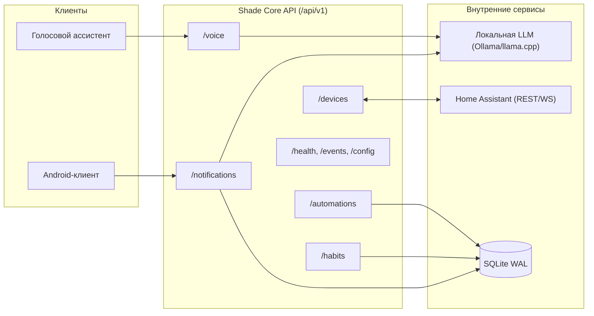

# Спецификация REST API: Shade Core

Данный документ содержит полную спецификацию программного интерфейса (REST API) серверного ядра **Shade Core** — бэкенда экосистемы **Shade AI**, развернутого на микрокомпьютере Raspberry Pi 5.

---

## 1. Общие сведения

- **Базовый URL:** `http://<raspberry-pi-ip>:8000/api/v1`
- **Протокол:** HTTP/1.1 (с поддержкой перехода на HTTP/2 и WebSocket в рамках расширений)
- **Формат данных:** `application/json; charset=utf-8` (за исключением эндпоинтов загрузки бинарных медиафайлов, использующих `multipart/form-data`)
- **Формат даты и времени:** Строка в стандарте ISO 8601 UTC (например, `2026-09-17T06:15:30Z`)
- **Интерактивная документация:** Доступна при запущенном сервисе по адресам `/docs` (Swagger UI) и `/redoc` (ReDoc).

---

## 2. Аутентификация и безопасность

Все запросы к защищенным эндпоинтам API должны содержать заголовок HTTP `Authorization` с Bearer-токеном (API Key):

```http
Authorization: Bearer <SHADE_API_KEY>
```

> [!NOTE]
> **Настройка API-ключа (TASK-01):** выполните `python -m app.setup` из `core/` после установки зависимостей. Команда создаёт случайный `SHADE_API_KEY` в `.env` с правами `600`, не выводит секрет и при повторном запуске сохраняет корректный существующий ключ. Core читает `SHADE_API_KEY` из окружения или `.env`; окружение имеет приоритет. Ключ обязателен: не менее 32 ASCII-символов без пробелов, демонстрационные значения не допускаются. Имя `API_KEY` не поддерживается. Без корректной настройки сервер прекращает запуск с подсказкой. Подробности — в [инструкции Core](../core/README.md). Сопряжение Android, systemd и `config.yaml` ещё не реализованы.

### Коды ошибок аутентификации

| Код | Описание | Причина |
| :--- | :--- | :--- |
| `401 Unauthorized` | Токен отсутствует или недействителен | Заголовок `Authorization` не передан или передан неверный токен |
| `403 Forbidden` | Доступ запрещен | Ключ заблокирован или не обладает требуемыми привилегиями |

---

## 3. Стандартный формат ошибок

В случае возникновения клиентской (`4xx`) или серверной (`5xx`) ошибки Shade Core возвращает структурированный JSON-ответ:

```json
{
  "error": {
    "code": "RESOURCE_NOT_FOUND",
    "message": "Уведомление с ID 'ntf_982341' не найдено",
    "details": {
      "id": "ntf_982341"
    },
    "timestamp": "2026-09-17T06:15:30Z"
  }
}
```

---

Фактические ошибки текущего Core используют FastAPI-формат `{"detail": ...}`. В 422 остаются только тип, безопасное имя поля и общее сообщение: исходные input/ctx и текст запроса не возвращаются. Обёртка error выше — целевой формат следующих этапов.

## Статус реализации (v0.1 — скелет)

| Эндпоинт | Статус | Реализация |
| :--- | :--- | :--- |
| `GET /health` | ✅ реализован | `core/app/api/v1/health.py` |
| `POST /notifications` | ✅ реализован | `core/app/api/v1/notifications.py` |
| `GET /notifications`, `GET /notifications/{id}` | ✅ реализованы (TASK-05) | `core/app/api/v1/notifications.py` |
| `POST /ha/action` | ✅ совместимый устаревший маршрут (TASK-06) | `core/app/api/v1/ha.py` |
| `GET /devices`, `GET /devices/{entity_id}/state`, `POST /devices/{entity_id}/command` | ✅ реализованы (TASK-06) | `core/app/api/v1/devices.py` |
| `GET /events` | ✅ журнал команд HA (TASK-06) | `core/app/api/v1/events.py` |
| `GET /telemetry`, `/telemetry/history`, `/telemetry/gaps` | ✅ выбранные датчики HA (TASK-14) | `core/app/api/v1/telemetry.py` |
| `GET /habits`, `/automations`, `GET/PUT /config`, `POST /voice` | ⏳ запланированы (v0.2–v0.5) | `docs/mvp.md` |

Отличия текущего скелета от целевого контракта:

- `id` уведомлений — целое число SQLite AUTOINCREMENT; UUID event_id отправителя используется отдельно для повторной доставки.
- `llm_status` в `/health` — not_loaded при выключенном локальном движке; в программной TASK-16 появляются loading/ready и безопасные коды ошибок. Распознавание уведомлений подключается отдельно в TASK-17.
- `POST /ha/action` сохранён для совместимости и помечен deprecated в OpenAPI. Удаление требует отдельного проверенного перехода клиентов.
- Маршруты устройств читают HA по REST. TASK-14 отдельно собирает выбранные датчики по WebSocket в локальный кэш/историю; `/devices` не подменяется кэшем. Журнал пока содержит только команды HA, а не все события будущей системы.
- Приём уведомления возвращает stored/duplicate/skipped без вызова заглушки LLM. Очередь реализована в TASK-15, реальный разбор — следующие задачи.

---

## 4. Эндпоинты API



---

### 4.1. Уведомления (Notifications) — реализовано в TASK-05

TASK-15 добавляет durable-очередь обработки. POST сохраняет прежний receipt stored/duplicate/skipped и не ожидает worker. В GET старый status=stored/processed сохранён для совместимости; точный статус передаётся новым processing_status=pending/processing/processed/failed. LLM пока не подключён; по умолчанию NOTIFICATION_PROCESSOR=disabled, явный diagnostic проверяет только конвейер. Идентификаторы сервера — положительные целые числа SQLite, после удаления не переиспользуются. [Инструкция и политика хранения](../core/README.md#уведомления-task-05).

#### 4.1.1. `POST /notifications` — принять уведомление

Нужны `Authorization: Bearer <SHADE_API_KEY>` и `Content-Type: application/json`.

| Поле | Тип | Обязательно | Ограничения |
| :--- | :--- | :--- | :--- |
| `app_name` | string | Да | Имя пакета, 3..255 символов: буквы/цифры/подчёркивания и точки, начало с буквы |
| `title` | string | Да | До 512 символов |
| `text` | string | Да | До 8192 символов; title и text не могут одновременно быть пустыми/пробельными |
| `timestamp` | string | Да | ISO 8601 с секундами и часовым поясом: Z или ±HH:MM, до 6 цифр долей секунды. Числовой epoch и дата без пояса не принимаются. Нормализуется в UTC с 6 цифрами долей секунды. Не более 5 минут в будущем |
| `priority` | string | Нет | min / low / default / high / max; default по умолчанию |
| `event_id` | string UUID или null | Нет | Стабильный UUID события на отправителе, одинаковый во всех повторах |

Неизвестные поля запрещены. Полное тело ограничено **65 536 байт**, включая chunked-запросы; превышение возвращает 413 до JSON-разбора. Ошибки валидации — 422 без исходного input/текста. Значения полей title/text не обрезаются и не преобразуются к строке автоматически.

**Повторная доставка:**

- С event_id один UUID обозначает одно событие. Повтор того же нормализованного содержимого даёт прежний id; тот же UUID с другим содержимым — 409.
- Без event_id для старых клиентов используется SHA-256 нормализованных app_name/title/text/timestamp/priority. Два одинаковых уведомления в тот же момент считаются повтором; разные UUID позволяют различить намеренно одинаковые события. Timestamp с разными поясами, обозначающий один момент, нормализуется одинаково.
- Уникальный индекс защищает от параллельных повторов. Идемпотентность действует пока запись хранится; просроченное исходное событие пропускается, а не создаётся заново. Гарантии доставки после потери ответа не требуют нового event_id: отправитель повторяет прежнее событие.

**Android, программная TASK-11:** новые строки Room v2 передают сохранённый event_id; title/text/timestamp одной версии неизменяемы на повторах. Одинаковый callback пропускается, изменение принятого содержимого создаёт новый UUID. Мигрированные строки v1 продолжают отправляться без event_id, чтобы сохранить прежнюю дедупликацию по отпечатку; оригинальный ключ Android у них неизвестен. Маршруты и формат запроса/ответа Core не менялись. [Буфер и ограничения клиента](../android/README.md#форматы-идентичность-и-локальный-буфер-task-11).

**Политика приватности:** по умолчанию допускаются ru.ozon.app.android, com.wildberries.ru, ru.yandex.taxi. NOTIFICATION_ALLOWED_APPS задаёт явный список доверенных служебных пакетов (JSON, до 100). Из него всегда исключены известные банковские пакеты, Telegram, WhatsApp и системные SMS-пакеты из серверного списка. Заголовок/текст с отдельными словами код*/парол*/пин*/code/otp/pin/password/cvv/cvc не сохраняется целиком. Это консервативное правило: код получения доставки тоже приводит к пропуску. Неизвестные приложения не допускаются по умолчанию; app_name — заявление доверенного клиента, а не проверенная Android-аттестация. Анализ произвольных личных сообщений не реализован.

По умолчанию хранение — **30 дней**, NOTIFICATION_RETENTION_DAYS допускает 1..365. Событие старше этого срока получает skipped/expired. Данные удаляются по возрасту timestamp или created_at, смотря что наступит раньше. Пропущенные уведомления не записываются, не хешируются для постоянного хранения и не передаются в шину/LLM.

| HTTP | status | id | Значение |
| :--- | :--- | :--- | :--- |
| 201 | stored | integer | Новая запись зафиксирована в БД |
| 200 | duplicate | integer | Возвращена существующая запись |
| 200 | skipped | null | Постоянной записи нет; reason=privacy_policy или expired |
| 409 | — | — | event_id уже связан с другим содержимым |
| 413 | — | — | Тело слишком велико |
| 422 | — | — | Некорректные поля, дата, приоритет или JSON |

Успешный ответ имеет поля id, status, reason (null для stored/duplicate), processed_data (пока всегда null). skipped — окончательный пропуск по политике, его не следует бесконечно повторять.

```bash
curl -X POST "http://<raspberry-pi-ip>:8000/api/v1/notifications" \
  -H "Authorization: Bearer <SHADE_API_KEY>" \
  -H "Content-Type: application/json" \
  -d '{
    "app_name": "ru.ozon.app.android",
    "title": "Доставка",
    "text": "Курьер прибудет вечером",
    "timestamp": "2026-10-17T11:00:00Z",
    "priority": "high",
    "event_id": "181d66f4-5401-4e97-b7be-059da5fc6282"
  }'
```

В примере замените timestamp актуальным временем события.

```json
{"id": 1, "status": "stored", "reason": null, "processed_data": null}
```

#### 4.1.2. `GET /notifications` — история

Требует Bearer. Параметры: limit=50 (1..200), offset=0 (0..1 000 000), category — необязательная строка до 64 символов по шаблону `[a-z][a-z0-9_]*`; processing_status — необязательный фильтр pending/processing/processed/failed. Некорректные значения дают 422. Сортировка — id по убыванию. total — число всех непросроченных записей, удовлетворяющих фильтру, независимо от limit/offset. Страница и total читаются в одной транзакции. При offset за концом items пуст, total сохраняется.

```json
{
  "items": [{
    "id": 1,
    "app_name": "ru.ozon.app.android",
    "title": "Доставка",
    "text": "Курьер прибудет вечером",
    "timestamp": "2026-10-17T11:00:00.000000Z",
    "priority": "high",
    "event_id": "181d66f4-5401-4e97-b7be-059da5fc6282",
    "status": "stored",
    "processing_status": "pending",
    "processing_attempts": 0,
    "processing_error_code": null,
    "processing_started_at": null,
    "processing_finished_at": null,
    "category": null,
    "processed_data": null,
    "created_at": "2026-10-17T11:00:01.000000Z"
  }],
  "total": 1
}
```

Категории пока автоматически не вычисляются. Просроченные и непроверенные legacy-записи не выдаются даже до очередной физической очистки.

#### 4.1.3. `GET /notifications/{id}` — одна запись

Требует Bearer. id — целое от 1 до 9223372036854775807; неверный формат/диапазон даёт 422. Возвращает объект того же формата, что items[] выше. Отсутствующая, удалённая или просроченная запись даёт 404 с `{"detail":"Уведомление не найдено"}`.

Очистка запускается до приёма запросов и затем раз в час. Новая отправка также удаляет просроченные строки в своей транзакции. При обновлении legacy-уведомления проходят тот же фильтр: недопустимые/старые удаляются, допустимые нормализуются и получают ключ повторов, одинаковые объединяются. Старые результаты заглушки/JSON очищаются. Старые резервные копии и физические следы SQLite/WAL этим логическим удалением не уничтожаются; регламент копий — TASK-08.

---

#### 4.1.4. Состояния обработки — TASK-15

GET списка и одной записи добавляет поля:

| Поле | Значение |
| :--- | :--- |
| `processing_status` | pending — в БД, processing — попытка начата, processed — результат сохранён, failed — попытка завершена ошибкой |
| `processing_attempts` | Число зафиксированных стартов, изначально 0; после аварийного восстановления увеличивается при следующем старте |
| `processing_error_code` | null либо PROCESSOR_ERROR / PROCESSOR_TIMEOUT / INVALID_RESULT / INVALID_NOTIFICATION / PROCESSING_INTERRUPTED или фиксированный LLM_* (§4.5.1) |
| `processing_started_at` | Время начала текущей/последней попытки UTC, null до запуска и после восстановления pending |
| `processing_finished_at` | Время фиксации processed/failed UTC, иначе null |

Прежний `status` сохранён для старых клиентов: processed только для processing_status=processed, в остальных случаях stored. Для точной диагностики использовать processing_status. POST всегда возвращает прежний receipt stored/duplicate/skipped и processed_data=null; повторная доставка не сбрасывает попытки/ошибку/результат. Получение HTTP-ответа не ожидает обработчика. GET поддерживает фильтр processing_status; total и страница используют общий фильтр/транзакцию.

По умолчанию `NOTIFICATION_PROCESSOR=disabled`: очередь остаётся в SQLite pending, health services.notification_worker=disabled. Независимый LLM_ENABLED тоже false по умолчанию. Явное `diagnostic` запускает технический тест конвейера. Его единственный результат — `{"processor":"diagnostic","llm":false}`, category=null; processed в этом режиме означает завершённую проверку очереди, **не анализ текста**. Не выдаёт noise и не вычисляет сущности/интенты. Web отличает диагностический результат от AI-анализа и показывает безопасные причины ошибок, число попыток; карточка обновляется каждые 5 секунд при видимости вкладки. Android receipt и логика доставки сохраняются.

Миграция 0006 добавляет статусы/индекс к notifications_raw. Прежние данные/ID сохраняются, существующие строки получают pending/0: старый is_processed/JSON не являются доказательством работы нового worker и до нового processed не выдаются как результат. Обработка пишет ограниченный проверенный JSON в существующий extracted_data_json, сохраняет совместимый is_processed. Diagnostic оставляет category=null; LLM записывает категорию из проверенного результата. Неизвестные поля результата отклоняются, тексты исключений/SQL-параметры/исходные payload в ошибки и служебные логи не попадают.

Один worker, один процесс Core на БД. FIFO по ID; очередь в RAM содержит только ID (NOTIFICATION_QUEUE_SIZE=64, диапазон 1..256), активен максимум один ограниченный входной payload. Остаток ожидает в SQLite; переполнение пачки памяти не отклоняет сохранённый POST. Это не квота размера БД: общая история и pending подчиняются сроку хранения уведомлений. Сигнал после commit ускоряет запуск; опрос раз в секунду восстанавливает работу и без сигнала. Сырая шина create_task не используется.

До вызова обработчика фиксируются processing и номер попытки, транзакция закрывается. Обработчик вызывается асинхронно вне HTTP и обязан не блокировать event loop/уважать отмену; CPU-инференс TASK-16 выполняется в дочернем процессе. NOTIFICATION_PROCESSING_TIMEOUT_SECONDS=30 (0.1..300). Ошибка/таймаут/неверный результат дают terminal failed и не блокируют следующую запись; failed автоматически не повторяется, HTTP retry-маршрута пока нет. При сбое commit результата worker повторяет только фиксацию одного проверенного результата, без повторного вычисления; storage_error виден в health. Неопределённый исход claim восстанавливается в том же процессе после восстановления БД.

При штатной остановке Core ждёт активную попытку до NOTIFICATION_SHUTDOWN_SECONDS=5 (0.1..30), затем отменяет её. Не взятые ID остаются pending; processing без финального commit при следующем старте становится pending с PROCESSING_INTERRUPTED, попытки не обнуляются. Это **как минимум одно вычисление**, а не exactly-once: после аварии оно может повториться. Обработчики должны быть чистыми, без вызовов HA/внешних действий; автоматических команд из результата нет. Успешные и failed записи после рестарта не вычисляются снова. Срок/допуск проверяются до вызова и при фиксации результата, удалённая/просроченная/исключённая строка не возрождается.

[Эксплуатация и воспроизведение](../core/README.md#очередь-обработки-уведомлений-task-15), [отчёт](reports/task-15.md).

#### 4.1.5. Результат извлечения — программная TASK-17

Явные `NOTIFICATION_PROCESSOR=llm` и `LLM_ENABLED=true` подключают очередь к одному LocalLLMEngine. При выключенном движке worker disabled, загрузка не включается неявно. До готовности модели worker сообщает `waiting_model`, при отказе загрузки — `model_unavailable`; уведомления остаются pending/attempts=0. Время загрузки не расходует бюджет отдельной попытки. После runtime timeout/отмены/выхода процесса перед следующим уведомлением выполняется явная повторная загрузка. Терминальный failed прежнего события не повторяется.

Внешний POST/receipt не меняется. Защищённые GET после processed возвращают `category` и `processed_data` следующей версии (пример для уведомления 2026-10-17T20:50:00Z):

```json
{
  "processor": "llm",
  "llm": true,
  "schema_version": 1,
  "category": "delivery",
  "priority": "high",
  "intent": "delivery_event",
  "entities": {"subject": "Курьер", "location": "Лесная 2", "service": "Ozon"},
  "time": {
    "source": "через 15 минут",
    "timezone": "Asia/Yekaterinburg",
    "at": "2026-10-17T21:05:00Z",
    "date": null,
    "resolution": "exact"
  },
  "action_authorized": false
}
```

| Поле | Версия 1 / ограничение |
| :--- | :--- |
| category | delivery / transport / calendar / reminder / noise |
| priority | low / default / high — распознанная важность, отдельно от исходного Android priority |
| intent | delivery_event / transport_event / calendar_event / reminder / none; однозначно выводится из category |
| entities.subject/location/service | null либо буквальная непустая цитата title/text, до 160/200/80 символов |
| time.source | null либо буквальная цитата до 128 символов |
| time.timezone | Настройка Core NOTIFICATION_TIMEZONE, IANA, default Asia/Yekaterinburg |
| time.at | Точный момент UTC ISO 8601 либо null |
| time.date | Локальная дата YYYY-MM-DD без выдуманного времени либо null |
| time.resolution | absent / exact / date_only / unresolved |
| action_authorized | Всегда false, без entity_id/HA-параметров/команд |

Реклама/обновление/прочее — noise с low, пустыми entities и absent time. Банки/личная переписка не добавляются в допуск; finance/communication из целевого примера архитектуры не включены в версию 1. Календарь/напоминания не расширяют allowlist автоматически: доверенный источник выбирается отдельно. Поле confidence не заполняется выдуманным числом модели; измерение качества — TASK-18. Категория/priority остаются вероятностным распознаванием, даже когда JSON/цитаты валидны.

Модель получает русский системный промпт, три отдельные синтетические пары примеров, затем JSON title/text как недоверенные данные. JSON Schema ограничивает вывод, Pydantic независимо проверяет типы/enum/размеры/лишние поля; дубликаты JSON-ключей, обрезанный ответ и неподтверждённые цитаты отклоняются с LLM_BAD_RESPONSE. Ответ модели ограничен 4 KiB, не сохраняется сырым при ошибке. Успех сохраняется через прежний атомарный finish worker в той же строке, category-фильтр работает по колонке. Новая миграция не требуется — схема БД не меняется.

Время нормализует код, не модель, от **timestamp уведомления**, никогда от текущего дня обработки. Входной offset уже нормализован при приёме в UTC, поэтому «сегодня/завтра» используют явно выбранный часовой пояс Core, а не догадку о телефоне. Поддержаны `через N минут/часов/дней` (до 365; сутки=24 ч), сегодня/завтра/послезавтра с необязательным `в HH:MM`, YYYY-MM-DD и DD.MM.YYYY с необязательным временем. Отсутствующее время даёт date_only; голые часы, день недели, диапазоны, «скоро», неизвестный формат, несуществующий/двойной час DST дают unresolved и null at/date. Если модель выбрала только часы, полный source сегодня/завтра/послезавтра либо с YYYY-MM-DD/DD.MM.YYYY восстанавливается только при единственной подходящей буквальной цитате в title/text; при разных днях результат остаётся unresolved. Часы из записи с секундами не достраиваются усечённой цитатой. Отсутствие time.source — absent. Прошедшую дату не сдвигать в будущее. Дальнейший планировщик обязан отдельно решать, допустимо ли назначение события; из извлечения ничего не отправляется в HA/календарь/уведомления.

### 4.2. Устройства умного дома — реализовано в TASK-06

Все маршруты раздела требуют `Authorization: Bearer <SHADE_API_KEY>`. Core использует отдельный HA_TOKEN для локального HA; ключ Core в HA не передаётся. Проверено на mock и локальном HTTP-стенде; управление физическим устройством — TASK-08.

`entity_id` — до 255 символов, шаблон `^[a-z][a-z0-9_]*\.[a-z0-9_]+$`. Домен и имя сервиса — 1..64 символа, `^[a-z][a-z0-9_]*$`. Некорректные значения возвращают 422 до обращения в HA.

#### 4.2.1. `GET /devices` — сущности из HA

Получает живой `GET /api/states` из HA. Не записывает DeviceState и не выдаёт устаревший кэш при отказе HA. Здесь «устройство» означает сущность HA, а не запись его device registry.

| Query | Ограничение | Поведение |
| :--- | :--- | :--- |
| `domain` | Необязательно, валидное имя домена | Фильтр по префиксу entity_id; без фильтра все сущности |

Ответ 200 — `{"devices": [...]}`; пустой список допустим. Каждая сущность имеет те же поля, что ответ следующего маршрута.

#### 4.2.2. `GET /devices/{entity_id}/state` — состояние сущности

Читает `GET /api/states/{entity_id}`. Неизвестная сущность — 404 с `detail.code=ENTITY_NOT_FOUND`.

```json
{
  "entity_id": "light.living_room",
  "name": "Свет в гостиной",
  "state": "on",
  "type": "light",
  "attributes": {"friendly_name": "Свет в гостиной", "brightness": 200},
  "last_changed": "2026-10-17T10:00:00Z",
  "last_updated": "2026-10-17T10:00:00Z"
}
```

Время нормализуется в UTC. `name` берётся из строкового friendly_name до 255 символов, иначе равен entity_id. `state` остаётся строкой HA (включая unknown/unavailable), `type` равен домену. Атрибуты возвращаются авторизованному клиенту, но в журнал и служебные логи не записываются.

#### 4.2.3. `POST /devices/{entity_id}/command` — вызов сервиса

```json
{"action": "turn_on", "params": {"brightness": 200}}
```

`action` обязателен; `params` — объект, по умолчанию `{}`. Неизвестные верхние поля запрещены. В корне params запрещены `entity_id`, `device_id`, `area_id`, `target`: целью остаётся только сущность из URL. Параметры сервиса проверяет HA; Core ограничивает JSON: тело до 65 536 байт (413), глубина до 8, до 512 узлов, до 64 элементов в объекте/массиве, ключ до 64 и строка до 8192 символов, только конечные числа (422).

Core сначала фиксирует запись `command_requested` в SQLite, затем вызывает `POST /api/services/{domain}/{action}` с params и заданным entity_id. Транзакция БД не удерживается во время сетевого запроса. Результат фиксируется в той же строке журнала до возврата ответа.

Ответ 200:

```json
{
  "status": "success",
  "entity_id": "light.living_room",
  "new_state": "on",
  "state_observed": true,
  "executed_at": "2026-10-17T10:00:00Z",
  "event_id": 42
}
```

`success` означает принятый HA вызов сервиса и сохранённый результат аудита. Он не подтверждает физическое выполнение. После ответа HA Core отдельно запрашивает состояние целевой сущности: список изменившихся состояний в ответе сервиса не считается состоянием цели. Если чтение не удалось, ответ всё равно 200, `new_state=null`, `state_observed=false`. Даже успешное чтение — наблюдение, а не ожидание достижения желаемого состояния. `executed_at` — время завершения вызова, `event_id` — целочисленный ID строки журнала.

**Повторы:** автоматических повторных отправок нет. Каждый POST — новая попытка и новая запись; ключа идемпотентности команд пока нет. При таймауте, потере ответа или сбое фиксации HA мог уже выполнить действие. Перед ручным повтором проверить журнал и состояние HA, особенно для toggle, замков и других необратимых действий.

#### 4.2.4. Совместимость: `POST /ha/action`

Сохранён прежний формат:

```json
{"domain": "light", "service": "turn_on", "entity_id": "light.living_room", "data": {"brightness": 200}}
```

`data` можно опустить или передать null; действуют те же ограничения, что для params. Домен должен совпадать с префиксом entity_id. Ответ сохраняет `status`, `entity_id`, `result` (ограниченный исходный список состояний HA) и добавляет `new_state`, `state_observed`, `executed_at`, `event_id`. Общие аудит и обработка ошибок те же. В новых клиентах использовать `/devices/{entity_id}/command`.

#### 4.2.5. Ошибки и границы обмена с HA

GET при отказе возвращает `{"detail":{"code":"HA_UNAVAILABLE"}}`. Для POST добавляются `event_id` и `outcome`, если запись попытки создана:

```json
{"detail": {"code": "HA_TIMEOUT", "event_id": 43, "outcome": "unknown"}}
```

| HTTP Core | code | Причина / outcome команды |
| :--- | :--- | :--- |
| 503 | HA_NOT_CONFIGURED | Пустой HA_TOKEN; not_sent, HTTP не выполняется |
| 503 | HA_AUTH_FAILED | HA ответил 401/403; rejected |
| 503 | HA_UNAVAILABLE | Ошибка соединения; not_sent для ConnectError, иначе unknown |
| 504 | HA_TIMEOUT | Connect/Pool timeout — not_sent; чтение/запись/общий таймаут — unknown |
| 502 | HA_SERVER_ERROR | HA ответил 5xx; unknown |
| 502 | HA_BAD_RESPONSE | Неверные JSON/схема/размер, redirect или неожиданный статус; unknown |
| 404 | ENTITY_NOT_FOUND | HA 404 при чтении состояния |
| 400 | HA_COMMAND_REJECTED | HA ответил 400/404/422 на вызов сервиса; rejected |
| 503 | AUDIT_UNAVAILABLE | Не удалось сохранить начальную запись; not_sent, команды в HA нет, event_id отсутствует |
| 503 | AUDIT_FINALIZATION_FAILED | Начальная запись есть, итог не сохранён; event_id и известный outcome, в том числе accepted |

`outcome=accepted` — HA принял сервис; `rejected` — отклонил; `not_sent` — запрос не отправлен; `unknown` — результат отправки неизвестен. Ошибка аудита после HA оставляет pending-запись для диагностики. На следующем старте она становится interrupted/unknown без повторной отправки.

Один AsyncClient на lifespan, закрытие при shutdown, пул до 8 соединений (2 keep-alive). HA_TIMEOUT_SECONDS=5 по умолчанию (0.1..30): общий бюджет одного HTTP-обмена, включая чтение; health ping ограничен также 2 секундами. Команда с последующим чтением может занять два таких бюджета плюс работу БД. Ответ HA ограничен 2 MiB декодированного тела и 5000 состояний. Redirect запрещён, HTTPS проверяет сертификат, proxy/CA-переменные окружения HTTPX не используются (`trust_env=False`). В URL не допускаются credentials, путь, query и fragment. HA_BASE_URL должен указывать на HA в доверенной локальной сети/VPN; принадлежность адреса частной сети автоматически не проверяется. Тексты ответов HA, исключений, токены и params не возвращаются в ошибках и не сохраняются в аудите.

---

#### 4.2.6. Телеметрия HA — TASK-14

Три маршрута требуют Bearer Core и читают локальную БД, не выполняя запросов в HA. Сбор включается только через `HA_TELEMETRY_ENTITIES` в окружении/`.env` и перезапуск Core; HTTP-маршрута изменения настройки пока нет. По умолчанию список пуст. Допускаются до 100 разных `sensor.*` с конечными числовыми значениями и `binary_sensor.*` с `on/off`, включая `unknown/unavailable`; текстовые sensor, person, device_tracker, календарь и другие домены не поддерживаются. Выбранный, но нечисловой sensor прерывает сессию с безопасным кодом `HA_BAD_SENSOR_STATE`.

**`GET /telemetry`** — диагностика сборщика и последние наблюдения выбранных сущностей:

```json
{
  "status": "connected",
  "error_code": null,
  "last_confirmed_at": "2026-10-18T01:00:30.000000Z",
  "retention_days": 90,
  "max_rows": 100000,
  "states": [{
    "entity_id": "sensor.room_temperature",
    "present": true,
    "state": "21.5",
    "attributes": {"unit_of_measurement": "°C", "device_class": "temperature"},
    "last_changed": "2026-10-18T01:00:00.000000Z",
    "last_updated": "2026-10-18T01:00:00.000000Z",
    "stale": false
  }]
}
```

`status`: `starting`, `disabled` (пустой выбор), `not_configured` (нет HA_TOKEN), `connecting`, `syncing`, `connected`, `disconnected`, `auth_failed`, `stopped`. `error_code` — null либо безопасный код последней ошибки: `HA_AUTH_FAILED`, `HA_UNAVAILABLE`, `HA_TIMEOUT`, `HA_BAD_RESPONSE`, `HA_BAD_SENSOR_STATE`, `HA_STATE_ORDER`, `HA_SUBSCRIPTION_FAILED`, `HA_SYNC_OVERFLOW`, `STORAGE_ERROR`, `TELEMETRY_ERROR`. Чужие сообщения/токены не возвращаются. При auth_failed сетевые попытки прекращаются до перезапуска после исправления настроек.

`last_confirmed_at` — локальное время последнего зафиксированного снимка или прикладного pong HA, null до первого успешного снимка. Это проверка потока, а не время изменения каждого датчика. При любом статусе кроме connected строки имеют `stale=true`; при смене baseline во время SQL-чтения флаг также консервативно true. Давно неизменявшееся значение может оставаться актуальным при работающем потоке; `unavailable` остаётся отдельным состоянием HA. `present=false` означает отсутствие в последнем снимке/событие удаления; до синхронизации это не подтверждение отсутствия. В этом случае state/время — null, attributes — `{}`. Последний кэш не выдаётся через `/devices` при отказе HA.

**`GET /telemetry/history`** — история, ID по убыванию. Query: `entity_id` (необязательный валидный EntityId), `limit` (1..100, по умолчанию 50), `offset` (0..500000, по умолчанию 0). Невыбранная сущность даёт пустой список. `total/items` читаются одной транзакцией; неверные параметры дают безопасный 422.

```json
{
  "items": [{
    "id": 42,
    "entity_id": "sensor.room_temperature",
    "state": "22",
    "attributes": {"unit_of_measurement": "°C"},
    "source": "ha_state_changed",
    "ha_timestamp": "2026-10-18T01:00:01.000000Z",
    "observed_at": "2026-10-18T01:00:01.100000Z"
  }],
  "total": 1, "limit": 50, "offset": 0
}
```

`source=ha_state_changed` — полученное после синхронизации событие, `ha_timestamp` — HA `time_fired`. `source=ha_snapshot` — снимок после подключения; `ha_timestamp=null`: он не доказывает, когда происходили изменения во время разрыва. `observed_at` — время записи Core. `state=null` — отсутствующая сущность, отличная от строк `unknown/unavailable`. Снимок добавляет по строке на выбранную сущность, даже если значение не изменилось; внутри сессии точный повтор состояния/разрешённых атрибутов с тем же last_updated не добавляется. Изменения разрешённых атрибутов сохраняются. При регрессе HA last_updated — разрыв с `HA_STATE_ORDER` и новый снимок, без перестановки истории задним числом.

Хранятся только state и строковые `unit_of_measurement/device_class/state_class` до 64 символов; friendly_name, context, old_state и произвольные атрибуты не сохраняются. Данные старше SENSOR_RETENTION_DAYS (90, диапазон 1..365) скрываются сразу. Очистка при старте, записи и heartbeat/обслуживании удаляет просроченное и снятые с выбора сущности, ограничивает историю SENSOR_HISTORY_MAX_ROWS (100000, диапазон 1000..500000). Ограничение использует окно последних ID, поэтому после удалений строк может остаться меньше лимита. Это ограниченный буфер, страницы offset могут сдвигаться при поступлении/очистке данных.

**`GET /telemetry/gaps`** — периоды неопределённого покрытия потока, по ID убыванию. `limit/offset` и обёртка `items/total/limit/offset` как у истории; элемент: `id`, `started_at`, `ended_at` (null пока открыт), `reason` (безопасный код причины открытия, например CORE_START, CORE_STOP, HA_UNAVAILABLE). Это общие интервалы сборщика, не доказательство покрытия каждого датчика до его первого снимка. Срок — SENSOR_RETENTION_DAYS; максимум 1000 последних ID, открытый интервал сохраняется. Очистка обрезает старую историю целиком, а не создаёт события датчиков.

Разрыв начинается консервативно от последней durable-проверки: обычно это интервал 30 секунд плюс таймаут до обнаружения сбоя, при задержках обработки он может быть больше. После аварийной остановки checkpoint восстанавливает начало gap; после штатной остановки gap уже записан. Он закрывается только при атомарном сохранении нового снимка/кэша. При первой установке отсчёт начинается с запуска Core; историю до установки восстановить нельзя. События, пришедшие во время handshake/получения снимка, не считаются непрерывным покрытием и не сохраняются как live; весь этот промежуток включён в gap. Пропущенные переходы не восстанавливаются и не интерполируются. Времена HA и Core имеют разный источник; для будущей аналитики нужна синхронизация часов.

Транспорт: `/api/websocket`, auth → subscribe_events(state_changed) → get_states, затем события и прикладной ping каждые 30 секунд. Handshake/ответы ограничены HA_TIMEOUT_SECONDS; при потерянном pong сессия закрывается. Переподключение 1→60 с с jitter до 20%, сброс после 60 с стабильной сессии; команды не повторяются. Ответ до 2 MiB/5000 состояний, до 256 сообщений во время ожидания результата; порог входного буфера 16 кадров. Proxy, redirects, сжатие и wire-логи выключены, WSS проверяет сертификат. Сам HA может передавать все доступные состояния/state_changed; отбор применяется в Core до записи. Реальный HA/Pi и длительный сбор ещё требуют TASK-08/27. [Эксплуатация и стенд](../core/README.md#телеметрия-ha-task-14).

---

### 4.3. Аналитика — программная TASK-20

#### 4.3.1. `GET /habits` — описательные профили присутствия

**Реализовано программно**, реальные 7–10 дней/Pi не проверены. Требуется `Authorization: Bearer <SHADE_API_KEY>`; без ключа 401. Параметров запроса нет. Аналитика выключена, пока явно не выбран `ANALYTICS_PRESENCE_ENTITY` из `HA_TELEMETRY_ENTITIES` (только binary_sensor, on=дома/off=вне дома). Датчик движения не считается сигналом присутствия автоматически. `ANALYTICS_TIMEZONE` — IANA, `ANALYTICS_INTERVAL_SECONDS` —60..86400, default 3600; изменение .env требует перезапуска.

Ответ 200: `habits` (до 4 профилей) и `analytics` (состояние/причины). Список отсортирован по устойчивому id, по старому config_key данные не выдаются. Профили не содержат action/target, не управляют HA, не являются готовой автоматизацией TASK-21.

| Поле | Формат/смысл |
| :--- | :--- |
| habits[].id | hbt_ +32hex; устойчив для entity/timezone/kind/day_group |
| description | Русское описание вида, группы дней и локального окна |
| confidence | Эвристический score 0..1; **не вероятность/статистическая гарантия** |
| last_seen | UTC ISO8601 последнего совпавшего live-перехода |
| pattern.kind | arrival_home / departure_home |
| pattern.day_group | weekdays (пн–пт) / weekends (сб–вс) |
| pattern.trigger / timezone | Явно выбранный binary_sensor / IANA-пояс |
| pattern.window_start / window_end | HH:MM локального времени, радиус 45 мин |
| pattern.wraps_midnight | Окно пересекает полночь; start может быть позже end |
| pattern.radius_minutes | 45 |
| evidence | support_days, eligible_days, dispersion_minutes (медиана круговых расстояний) |
| analytics.status | disabled / starting / calculating / insufficient_data / insufficient_coverage / no_pattern / ready / too_many_observations / too_many_gaps / invalid_checkpoint / ANALYTICS_ERROR / ANALYTICS_INVALID_SNAPSHOT |
| analytics.entity_id / timezone | Выбор пользователя, null entity при выключенной аналитике |
| analytics.computed_at / stale | Снимок UTC; stale при отсутствии/другой конфигурации/пересчёте/ошибке/возрасте >2 интервалов |
| analytics.telemetry_stale | Текущий сборщик не connected; исторический профиль не доказывает актуальное присутствие |
| analytics.version / window_start / window_end | Версия 1, 30 последних полных локальных дней [start,end), без текущего дня; отсутствуют до первого расчёта |
| analytics.diagnostics | Число наблюдений, полных/допущенных дней, покрытие, группы дней и причины исключения coverage/gap/clock/unknown/snapshot/unstable |
| analytics.score_kind | heuristic_regularity_not_probability |
| analytics.action_authorized | Всегда false |

Один первый уход и последний приход в сутки; повторы того же state не увеличивают поддержку. Снимки не являются переходами. Исключаются неполные/неподтверждённые сутки, любые gaps, unknown/unavailable, скачок snapshot, рассогласование HA/Core >120 с, переход через границу локального дня из-за расхождения часов, более 8 переходов/сутки или смены чаще 60 с. Окна считают круговое расстояние минут суток с учётом полуночи; полные сутки используют IANA-пояс и могут иметь 23/25 часов при DST.

Для профиля нужны общий охват ≥7 дней, ≥5 допущенных будней либо ≥4 выходных, общее покрытие ≥70%, поддержка ≥80% допущенных дней группы и медианный разброс ≤15 мин в окне±45 мин. `confidence = support_days/eligible_days × min(eligible_days/10,1) × (1−dispersion_minutes/45) × общее_покрытие`. Пять идеальных будней дают score0.5, а не уверенную единицу. Эти пороги требуют проверки на реальных данных и не дают разрешения на автоматизацию.

Чтение ограничено 10000 наблюдениями (+контрольная строка, включая baseline) и 1000 gaps. Переполнение не подменяется усечённой уверенной выборкой. Если старые gaps уже удалены ограничением хранения, более ранний интервал исключается консервативно. Расчёт вне event loop, снимок/профили записываются одной транзакцией. При сбое старый снимок может оставаться, но помечается stale; raw-исключения/тексты/атрибуты не возвращаются. Отключение аналитики на следующем старте очищает производные профили/снимок, исходную телеметрию не удаляет. Новая ревизия 0007_habit_profiles.

```bash
curl http://<core>:8000/api/v1/habits -H "Authorization: Bearer <SHADE_API_KEY>"
```

По умолчанию `habits=[]`, `analytics.status=disabled`, `action_authorized=false`. `ready` означает обнаруженный исторический профиль, а не аппаратную приёмку или актуальный сигнал для команды. [Проверки и ограничения](reports/task-20.md).

---

### 4.4. Предложения сценариев и локальные подсказки — программная TASK-21

Предыдущее расширенное [ТЗ CRUD автоматизаций](automation-target-spec.md) сохранено отдельно; его маршруты пока не реализованы.

Только Bearer, без облачного push. Принятие/обновление само не отправляет команду HA. Исполнитель TASK-22 реализован, **по умолчанию выключен**; условия и журнал описаны в §4.4.6. Произвольные POST /automations и PUT/DELETE CRUD из целевого ТЗ ещё не реализованы; текущие предложения создаются только из профилей TASK-20. Допуск целей — `AUTOMATION_ALLOWED_LIGHTS` (JSON-массив до20 уникальных light.*, default[]), период `SUGGESTIONS_INTERVAL_SECONDS` 5..3600, default30. Настройки требуют перезапуска.

#### 4.4.1. `GET /automations`

Параметры: status (pending/accepted/rejected/disabled/needs_review, optional), limit1..20 (default20), offset0..200. Ответ200: automations[], total, allowed_targets[], status и executor_status (disabled/starting/ready/capacity/EXECUTOR_ERROR). До200 предложений, до4 новых по текущему источнику, генерация при свежем профиле со score≥0.75.

Объект предложения:

- id=aut_+32hex, source_habit_id, name, status, version (целая положительная ревизия), created_at/updated_at UTC.
- trigger: type=presence_transition, kind=arrival_home/departure_home, entity_id выбранного binary_sensor, from_state/to_state off→on или on→off, day_group weekdays/weekends, timezone, window_start/window_end HH:MM, wraps_midnight.
- evidence: support_days/eligible_days/dispersion_minutes, confidence — эвристическая регулярность, не вероятность.
- action=null до выбора цели; после принятия {entity_id:light.*,service:turn_on|turn_off,params:{}}. Приход — только turn_on, уход — turn_off. Произвольные params/сервисы не принимаются.
- execution_policy: version=1, enabled, home_presence_entity (null/выбранный binary_sensor), cancel_seconds10..120, cooldown_seconds300..86400, max_event_age_seconds=300, pair_window_seconds=90. approval_scope —64hex-хеш показанных условий/целей/политики; клиент передаёт его при принятии. Неизвестная версия политики не позволяет принять правило.
- source_current — совпадают свежий профиль, конфигурация и условия. approval_valid/enabled — сохраняется явное решение для **этой** цели/условий/политики. executable означает разрешение исполнителя при действующем согласии и включённом режиме, не факт срабатывания/отправки. Проверяются два источника и остальные gates §4.4.6. executor_status — состояние сервиса, по умолчанию disabled.

Rejected/disabled не возвращаются в pending при обычном пересчёте. У принятых изменение условий/потеря достаточного источника или разрешений переводит в needs_review и снимает одобрение; обновление одной статистики не меняет действие. При временно устаревшем расчёте одобрение не выполняется. Все проверки свежести/хеша повторяются на решении, нельзя одобрить устаревшие параметры по старой карточке.

#### 4.4.2. `GET /automations/{rule_id}`

Тот же объект + history (до20 последних): id, decision, version, target_entity, created_at. История содержит только метаданные, без исходных сообщений/params. Решения accept/reject/disable и служебные suggested/source_changed/evidence_updated/source_unavailable/approval_invalidated. Общая история ограничена1000 записями/90днями. Неизвестный id404 (AUTOMATION_NOT_FOUND); формат id aut_+32hex.

#### 4.4.3. `POST /automations/{rule_id}/decision`

Строгий JSON, лишние поля запрещены. Все POST /automations/* ограничены65536байт (413 при превышении).

```json
{"decision":"accept","version":1,"target_entity":"light.entry","approval_scope":"<64hex из прочитанной карточки>"}
```

Accept требует явной разрешённой цели, свежего профиля и совпадающей версии. При включённом исполнителе требуется совпадающий approval_scope, иначе409 AUTOMATION_SCOPE_CHANGED: старый клиент без показанной политики не даёт согласия на выполнение. При выключенном режиме поле необязательно ради совместимости TASK-21, но переданное проверяется; включение режима меняет хеш и требует нового accept. Reject/disable передаются без target_entity/approval_scope. Disable принимается и с устаревшей версией, чтобы новое состояние не мешало выключению. Ответ200 — актуальный объект; создание записи/новая версия/история атомарны. Гонки/неподтверждённые ошибки не следует автоматически переигрывать как новое решение.

Коды: 404 AUTOMATION_NOT_FOUND; 409 AUTOMATION_CHANGED/AUTOMATION_SOURCE_STALE/AUTOMATION_SCOPE_CHANGED; 422 AUTOMATION_TARGET_NOT_ALLOWED либо безопасная ошибка валидации; 503 SUGGESTIONS_UNAVAILABLE. Ошибка не возвращает raw input, тело/исключения/SQL-параметры не логируются. Одновременные accept с одной версией дают одно принятие и409; не две записи истории.

#### 4.4.4. `POST /automations/refresh`

Без тела, только синхронизация предложений/подсказок, не одобрение и не исполнение. Ответ {status}; при сбое503 SUGGESTIONS_UNAVAILABLE. Фон делает то же с заданным интервалом. SQLite writer для короткой read/write транзакции резервируется до чтения (BEGIN IMMEDIATE); сети/LLM ожиданий внутри нет. Та же оговорка применяется к связанным write-транзакциям телеметрии/профилей: обычные read/DDL транзакции сохраняют прежнее поведение.

#### 4.4.5. `GET /hints`

Локальная лента, отдельный cursor каждого клиента: after_id≥0 (до int64max, default0), limit1..20 (default20). Ответ:

```json
{"feed_id":"11111111-1111-4111-8111-111111111111","latest_id":5,"next_id":5,
 "hints":[{"id":5,"kind":"arrival_delivery","notification_id":42,"created_at":"2026-10-19T01:00:00Z"}]}
```

latest_id — текущий максимум ленты, next_id — последняя возвращённая запись (при пустом результате after_id). Монотонный AUTOINCREMENT не переиспользует удалённые ID; feed_id сохраняется между перезапусками и меняется при новой БД. После новой ленты/отката курсора клиент начинает с latest_id, не уведомляет о старом. Один клиент не подтверждает подсказки за другой; GET не изменяет ленту. Хранение7дней/до1000 записей; старый config_key не выдаётся.

Подсказка только при свежем live off→on явно выбранного присутствия, connected сборщике/checkpoint≤90с, последовательных согласованных временах и без gap. Snapshot/такси/LLM сами по себе не доказывают приход. Требуется существующий канонически принятый processed delivery с валидной schema1/action_authorized=false из разрешённого приложения, полученный Core за последние сутки. В ленте **нет** текста/сущностей/адреса из уведомления — только вид и ID контекста. Текст клиента фиксирован: «Вы дома. В Core есть событие доставки». До одной подсказки/час; один контекст не повторяется сутки; повтор события не создаёт новую запись.

Android использует только opt-in системные уведомления, разрешение Android13+, локальный WorkManager15мин + ручную проверку, без FCM. По умолчанию выключен. Смена ServerPrefs revision снимает прежний opt-in; API-ключ берётся из Keystore, не передаётся в WorkManager Data. Курсор содержит только feed_id/ID и привязан к revision. После401/403/404 фоновая проверка на паузе до явного повтора/настройки. Отсутствие INTERNET/VALIDATED не запрещает LAN, полностью без сетей HTTP не запускается. Doze/OEM/force-stop могут задержать работу; реальный срок и системная доставка ещё требуют проверки APK/телефона. Повтор использует стабильный notification tag/onlyAlertOnce; атомарности с Android NotificationManager нет — строгая exactly-once доставка не заявлена.

Миграция0008_suggestions_hints добавляет automation_rules/automation_decisions/local_hints/local_hint_state. [Реализация, проверки и ограничения](reports/task-21.md).

#### 4.4.6. Исполнение прихода/ухода — программная TASK-22

Настройки: AUTOMATION_EXECUTION_ENABLED=false, AUTOMATION_HOME_PRESENCE_ENTITY=null, AUTOMATION_CANCEL_SECONDS=30 (10..120), AUTOMATION_COOLDOWN_SECONDS=1800 (300..86400). Для включения обязательны выбранный личный ANALYTICS_PRESENCE_ENTITY, другой выбранный binary_sensor **общего присутствия всех жильцов** и непустой разрешённый свет. Общее присутствие не должно быть копией личного датчика; действительное покрытие дома требует аппаратной приёмки. Настройки требуют перезапуска/нового подтверждения. Прежние approvals TASK-21 переводятся в needs_review из-за новой политики.

Для кандидата нужны два последних согласованных live-перехода одинакового направления (off→on приход/ on→off уход), предыдущие противоположные состояния, не snapshot/unknown. Оба перехода не старше300с и с разницей≤90с, HA-время согласовано≤120с, checkpoint≤90с, collector connected и нет gap со времени предыдущих наблюдений. Срабатывание в локальном окне/группе дней правила. Если другой человек остаётся дома, общий датчик on и уход не допускается. Один личный датчик/LLM-контекст не разрешает команду.

Кандидат durable pending до cancel_seconds; перед отправкой заново проверяются согласие/источники/ID/время/политика. Cancel/disable/reject до dispatching запрещают отправку. В dispatching начинается необратимая фаза: последующая отмена409, выключение запрещает будущие действия, уже начатая команда может завершиться. Cooldown общий для цели, учитывает неудачные/неизвестные попытки. Один переход/правило не переигрывается при повторе/новом согласии. После рестарта pending→cancelled, dispatching→unknown, команды автоматически не повторяются. HA success означает принятие, состояние отдельно наблюдается старым audit-путём.

Журнал0009_automation_runs: максимум1000 записей, terminal TTL90дней; при заполнении удаляются самые старые terminal старше суток, свежие ID сохраняются. Если всё свежее — capacity, новые кандидаты не создаются. Pending максимум20; цикл2с/≤200правил (актуальных профилей≤4). Только метаданные без params/личных сообщений. Короткая writer-транзакция фиксирует dispatching до сети; execute_command пишет отдельный pending-аудит до HA. Отказ аудита до отправки не посылает команду, сбой итогового commit не повторяет HTTP.

`GET /automations/runs?limit=20&before_id=<id>` — Bearer, limit1..20, before_id≥1 optional. Ответ200 {status,runs[]}, по убыванию ID. Поля: id,rule_id,state,reason,target_entity,service,created_at,due_at,started_at,finished_at,event_id,cancellable. state: pending/cancelled/dispatching/succeeded/failed/unknown/skipped. cancellable только pending; event_id связывает с обычным журналом команд.

`POST /automations/runs/{run_id}/cancel` — Bearer, без параметров, лимит тела64KiB.200 {status:"cancelled"} для pending/уже cancelled;404 AUTOMATION_RUN_NOT_FOUND,409 AUTOMATION_RUN_ALREADY_DISPATCHED для прочих состояний,503 AUTOMATION_RUN_UNAVAILABLE. Отменённый переход не планируется заново. Web показывает последние20 действий и кнопку отмены до отправки; неизвестный результат не предлагается повторять.

Фиксированные reason: WAITING_CANCEL_WINDOW,CORE_RESTARTED,USER_CANCELLED,RULE_DISABLED,APPROVAL_CHANGED,PRESENCE_UNCONFIRMED,COOLDOWN,COMMAND_IN_FLIGHT,HA_ACCEPTED,AUDIT_UNAVAILABLE,AUDIT_FINALIZATION_FAILED,HA_UNCONFIRMED,HA_FAILED,COMMAND_UNCONFIRMED. Неизвестный код клиент показывает общей подписью. Health services.automation_executor отражает фактический статус сервиса. [Проверки и ограничения](reports/task-22.md).

---

### 4.5. Система и диагностика (System)

Эндпоинты контроля состояния сервера Shade Core, метрик ресурсов Raspberry Pi 5, журнала событий и конфигурации.

#### 4.5.1. `GET /health` — реализовано в TASK-06

Доступен без Bearer. Выполняет `SELECT 1` и ping HA, освобождает read-транзакцию БД до ожидания HA. Это проверка доступности БД, а не полного integrity/schema check. Путь БД и секреты не выдаются.

- HTTP 200/status=ok: БД доступна и HA ping успешен.
- HTTP 200/status=degraded: БД доступна, HA недоступен или не настроен. Приём уведомлений продолжает работать.
- HTTP 503/status=error: ошибка доступа к БД, независимо от HA.

```json
{
  "status": "ok",
  "uptime": 3600,
  "ha_connected": true,
  "ha_status": "connected",
  "db_connected": true,
  "llm_status": "not_loaded",
  "db_size": "0.1 MB",
  "db_size_bytes": 102400,
  "services": {
    "database": "ready",
    "home_assistant": "connected",
    "llm": "not_loaded",
    "notification_worker": "disabled",
    "analytics": "not_implemented"
  }
}
```

`uptime` — целые секунды с импорта модуля в текущем процессе. `ha_status` и services.home_assistant равны connected либо безопасному коду HA_* из §4.2.5. Старые поля сохранены; клиентам нужно принимать degraded/error. db_size_bytes — размер основного SQLite-файла вместе с WAL (без SHM), 0 для memory, null при ошибке чтения размера; строковый db_size тогда unknown. Размер — текущая оценка, запись может менять файл во время подсчёта. services.analytics отражает состояние описательного анализатора TASK-20; по умолчанию disabled.

Services.notification_worker показывает starting/disabled/idle/processing/storage_error/stopped; TASK-17 добавляет waiting_model/model_unavailable. Это состояние конвейера, не наличие модели.

В программной TASK-16 `llm_status` и `services.llm` совпадают: `not_loaded` при LLM_ENABLED=false, `loading` при фоновой загрузке, `ready` после её успеха либо фиксированный код `LLM_*`. Возможны MODEL_MISSING/MODEL_INVALID/MODEL_TOO_LARGE/DEPENDENCY_MISSING/MEMORY_LIMIT/LOAD_FAILED/LOAD_TIMEOUT/TIMEOUT/INFERENCE_FAILED/CONTEXT_EXCEEDED/BAD_RESPONSE/PROCESS_EXITED/CANCELLED с префиксом LLM_. Служебные вызовы также используют LLM_DISABLED/NOT_READY/BUSY/CLOSED. Путь, содержимое модели, exception и текст уведомления не возвращаются. Клиент переводит неизвестный код общей ошибкой, не показывает его raw.

`ready` означает загруженный локальный движок, а не проверенное качество извлечения, подключённый worker или готовый алгоритм привычек. Отказ LLM не меняет HTTP-код/общий status health, определяемый БД/HA, и не блокирует приём уведомлений/ручные команды. Инференс идёт в отдельном процессе; одного загруженного экземпляра достаточно, параллельный запрос получает LLM_BUSY. После timeout/отмены процесс завершается; явная повторная загрузка относится к внутреннему потребителю, HTTP-метод управления моделью не добавлен. Базовый образ не содержит optional LLM-пакет и модели.

#### 4.5.2. `GET /events` — журнал команд HA (TASK-06)

Требует Bearer. Другие источники/типы будущего общего журнала пока не выдаются. Записи source=home_assistant; сортировка по ID убыванию, ID целочисленный SQLite AUTOINCREMENT, после удаления не переиспользуется.

| Query | Значение по умолчанию | Ограничение / смысл |
| :--- | :--- | :--- |
| limit | 100 | 1..500 |
| offset | 0 | 0..1 000 000 |
| from | нет | Включительная нижняя граница |
| to | нет | Исключительная верхняя граница для ISO timestamp; дата включает весь указанный день UTC |
| type | нет | command_requested / command_executed / command_failed / command_interrupted |

Время: дата YYYY-MM-DD либо ISO 8601 с `T` и часовым поясом (до 40 символов); timestamp нормализуется в UTC. Например, from=2026-10-17&to=2026-10-17 охватывает один день, до 2026-10-18T00:00:00Z. Некорректный/обратный/пустой диапазон и неизвестный type — 422. total — число всех доступных записей после фильтров, до limit/offset; count и страница читаются в одной транзакции. При новых вставках offset между разными запросами может сдвигаться.

```json
{
  "events": [{
    "id": 42,
    "timestamp": "2026-10-17T10:00:00Z",
    "source": "home_assistant",
    "type": "command_executed",
    "payload": {
      "request_id": "602360a8-2326-412f-b0eb-b6966fba464d",
      "entity_id": "light.living_room",
      "domain": "light",
      "service": "turn_on",
      "status": "success",
      "error_code": null,
      "outcome": "accepted"
    }
  }],
  "total": 1
}
```

Одна строка на попытку: command_requested/pending → command_executed/success либо command_failed/failed. Поле outcome уточняет факт отправки; failed/unknown не означает, что HA гарантированно не выполнил действие. Timestamp обновляется на время результата; на старте pending становится command_interrupted/unknown с CORE_RESTARTED и прежним временем. После сбоя отправка не повторяется.

В payload только перечисленные метаданные; params, токены, произвольные тексты и ответы/атрибуты HA не сохраняются. При чтении старых записей произвольные поля отбрасываются. Политика хранения — EVENT_RETENTION_DAYS=90 (1..365); просроченные сразу скрываются из GET, удаляются при старте и раз в час. Логическое удаление не уничтожает резервные копии и остатки SQLite/WAL.

#### 4.5.3. `GET /config` — Текущая конфигурация

Возвращает активную конфигурацию Shade Core (за исключением секретных токенов и паролей).

##### Заголовки (Headers)
| Заголовок | Тип | Обязательный | Описание |
| :--- | :--- | :--- | :--- |
| `Authorization` | `string` | Да | `Bearer <SHADE_API_KEY>` |

##### Поля успешного ответа (200 OK)
| Поле | Тип | Описание |
| :--- | :--- | :--- |
| `server` | `object` | Настройки хоста, порта и путей |
| `home_assistant` | `object` | URL подключения к Home Assistant и флаги синхронизации |
| `llm` | `object` | Название активной локальной модели, температура, контекстное окно |
| `logging` | `object` | Уровень детализации логов (`DEBUG`, `INFO`, `WARNING`) |

##### Пример cURL-запроса
```bash
curl -X GET "http://<raspberry-pi-ip>:8000/api/v1/config" \
  -H "Authorization: Bearer <SHADE_API_KEY>"
```

##### Пример ответа (HTTP 200)
```json
{
  "server": {
    "host": "0.0.0.0",
    "port": 8000,
    "environment": "production"
  },
  "home_assistant": {
    "base_url": "http://127.0.0.1:8123",
    "sync_interval_seconds": 30
  },
  "llm": {
    "engine": "ollama",
    "model": "tinyllama:1.1b-chat-v1.0-q4_K_M",
    "temperature": 0.2,
    "context_length": 2048
  },
  "logging": {
    "level": "INFO",
    "retention_days": 14
  }
}
```

---

#### 4.5.4. `PUT /config` — Обновить конфигурацию

Обновляет динамические параметры конфигурации без необходимости полного перезапуска сервиса.

##### Заголовки (Headers)
| Заголовок | Тип | Обязательный | Описание |
| :--- | :--- | :--- | :--- |
| `Authorization` | `string` | Да | `Bearer <SHADE_API_KEY>` |
| `Content-Type` | `string` | Да | `application/json` |

##### Тело запроса (Request Body)
| Поле | Тип | Обязательное | Описание |
| :--- | :--- | :--- | :--- |
| `llm` | `object` | Нет | Параметры LLM (модель, температура и т.д.) |
| `logging` | `object` | Нет | Параметры логирования |
| `home_assistant` | `object` | Нет | Параметры подключения к Home Assistant |

##### Поля успешного ответа (200 OK)
| Поле | Тип | Описание |
| :--- | :--- | :--- |
| `status` | `string` | Результат применения изменений (`applied`) |
| `updated_config`| `object` | Результирующий актуальный конфигурационный объект |

##### Пример cURL-запроса
```bash
curl -X PUT "http://<raspberry-pi-ip>:8000/api/v1/config" \
  -H "Authorization: Bearer <SHADE_API_KEY>" \
  -H "Content-Type: application/json" \
  -d '{
    "llm": {
      "model": "phi-2:2.7b-q4_K_M",
      "temperature": 0.1
    },
    "logging": {
      "level": "DEBUG"
    }
  }'
```

##### Пример ответа (HTTP 200)
```json
{
  "status": "applied",
  "updated_config": {
    "server": {
      "host": "0.0.0.0",
      "port": 8000,
      "environment": "production"
    },
    "home_assistant": {
      "base_url": "http://127.0.0.1:8123",
      "sync_interval_seconds": 30
    },
    "llm": {
      "engine": "ollama",
      "model": "phi-2:2.7b-q4_K_M",
      "temperature": 0.1,
      "context_length": 2048
    },
    "logging": {
      "level": "DEBUG",
      "retention_days": 14
    }
  }
}
```

---

### 4.6. Голосовой ввод и команды (Voice)

Прием голосовых данных со смартфона или микрофонных станций. Поддерживает два формата передачи:
1. **Бинарный аудиофайл** (`multipart/form-data`) для последующей локальной транскрибации (STT).
2. **Текстовая команда** (`application/json`), предварительно расшифрованная системным `SpeechRecognizer` на Android-устройстве.

#### 4.6.1. `POST /voice` — Отправить голосовой ввод

##### Вариант А: JSON с готовым текстом команды

###### Заголовки (Headers)
| Заголовок | Тип | Обязательный | Описание |
| :--- | :--- | :--- | :--- |
| `Authorization` | `string` | Да | `Bearer <SHADE_API_KEY>` |
| `Content-Type` | `string` | Да | `application/json` |

###### Тело запроса (Request Body)
| Поле | Тип | Обязательное | Описание |
| :--- | :--- | :--- | :--- |
| `text` | `string` | Да | Расшифрованный текст голосовой команды |

###### Пример cURL-запроса
```bash
curl -X POST "http://<raspberry-pi-ip>:8000/api/v1/voice" \
  -H "Authorization: Bearer <SHADE_API_KEY>" \
  -H "Content-Type: application/json" \
  -d '{
    "text": "Включи подсветку на кухне и сделай теплый свет"
  }'
```

---

##### Вариант Б: multipart/form-data с аудиофайлом

###### Заголовки (Headers)
| Заголовок | Тип | Обязательный | Описание |
| :--- | :--- | :--- | :--- |
| `Authorization` | `string` | Да | `Bearer <SHADE_API_KEY>` |
| `Content-Type` | `string` | Да | `multipart/form-data` |

###### Форма данных (Form Data)
| Поле | Тип | Обязательное | Описание |
| :--- | :--- | :--- | :--- |
| `audio` | `file` (binary) | Да | Аудиофайл с записью голоса (`audio/wav`, `audio/ogg`, `audio/m4a`) |
| `language` | `string` | Нет | Код языка распознавания (по умолчанию `"ru"`) |

###### Пример cURL-запроса
```bash
curl -X POST "http://<raspberry-pi-ip>:8000/api/v1/voice" \
  -H "Authorization: Bearer <SHADE_API_KEY>" \
  -F "audio=@/path/to/voice_sample.wav;type=audio/wav" \
  -F "language=ru"
```

---

##### Поля успешного ответа (200 OK)
| Поле | Тип | Описание |
| :--- | :--- | :--- |
| `transcription` | `string` | Распознанный текст голосового ввода |
| `intent` | `string` | Определенное намерение пользователя (`device_control`, `query_state`, `conversation`) |
| `action_executed` | `boolean` | Признак успешного автоматического выполнения команды |
| `execution_result` | `object` | Результат взаимодействия с исполнительным устройством |
| `response_text` | `string` | Ответный текст ассистента для озвучивания (TTS) или показа в UI |

##### Пример ответа (HTTP 200)
```json
{
  "transcription": "Включи подсветку на кухне и сделай теплый свет",
  "intent": "device_control",
  "action_executed": true,
  "execution_result": {
    "entity_id": "light.kitchen_under_cabinet",
    "state": "on",
    "color_temp": 3000
  },
  "response_text": "Подсветка на кухне включена в теплом спектре"
}
```

---

## 5. Таблица кодов ответов HTTP

| HTTP-код | Статус | Применение в Shade Core |
| :--- | :--- | :--- |
| `200 OK` | Успешный запрос | Успешное чтение данных, выполнение команды или обновление конфигурации |
| `201 Created` | Успешно создано | Успешная регистрация входящего уведомления или создание автоматизации |
| `204 No Content` | Нет содержимого | Успешное удаление сущности без возврата тела ответа |
| `400 Bad Request` | Неверный запрос | Ошибки валидации формата параметров или синтаксиса |
| `401 Unauthorized` | Не авторизован | Отсутствует, просрочен или некорректен заголовок `Authorization: Bearer ...` |
| `403 Forbidden` | Запрещено | Недостаточно прав для выполнения операции |
| `404 Not Found` | Не найдено | Запрашиваемое уведомление, устройство или автоматизация не найдены |
| `413 Content Too Large` | Превышен размер | Тело уведомления или команды больше 65 536 байт |
| `422 Unprocessable Entity` | Семантическая ошибка | Ошибка валидации схемы Pydantic (неверный тип поля в теле запроса) |
| `500 Internal Server Error`| Ошибка сервера | Необработанное исключение в коде Shade Core |
| `502 Bad Gateway` | Ошибка HA | HA 5xx или неверный/слишком большой ответ |
| `503 Service Unavailable` | Сервис недоступен | БД/аудит/подключение/авторизация HA; LLM — будущий контракт |
| `504 Gateway Timeout` | Таймаут HA | Превышен бюджет HTTP-обмена с HA |
