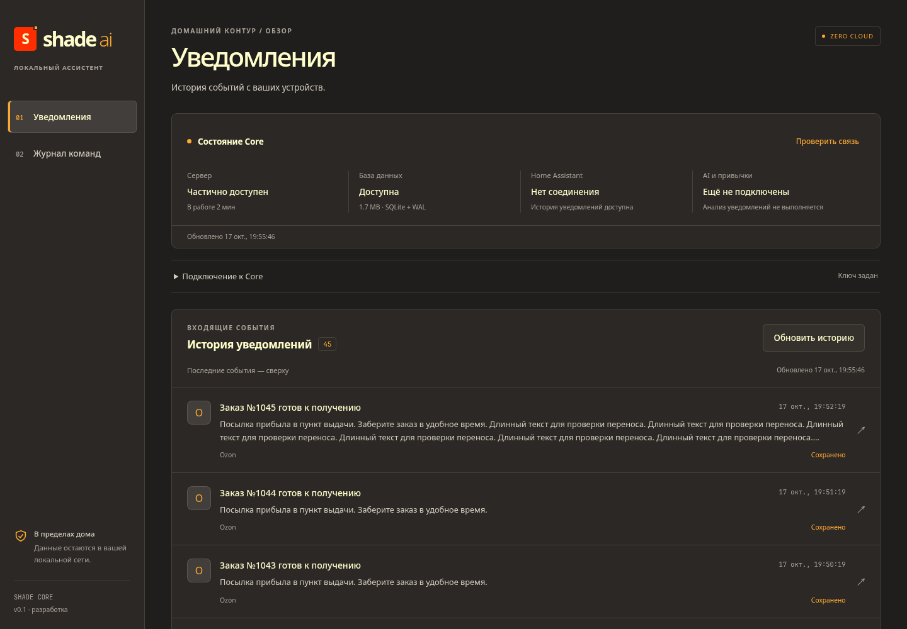

# TASK-07 — базовый веб-интерфейс и браузерная приёмка

**Дата:** 2026-10-17. **База:** `fe91009` (TASK-06). **Статус:** выполнена.

Задача — [mvp.md](../mvp.md), запуск и повторение проверок — [Web README](../../web/README.md). Контракт REST Core и его код не менялись. Новых runtime-зависимостей нет, package.json/lock сохранены.

## Что изменилось

Вместо одного экрана с общей ошибкой для health и уведомлений появились два раздела: история уведомлений и журнал команд. Диагностика Core остаётся доступной независимо от ключа и ошибок защищённых запросов.

- **Уведомления:** по 20 записей с total, навигация назад/вперёд, пустое состояние, полный текст и сведения записи в модальном dialog. Длинные тексты переносятся; превью ограничено двумя строками. Отсутствующая/просроченная запись объясняется пользователю.
- **Журнал:** по 20 попыток команд, фильтр результата и сброс offset при его смене. Показываются сущность, сервис, время, ID попытки, ошибка и смысл outcome. Accepted обозначается «Принята HA», unknown поясняет возможность выполненного действия. Кнопок отправки/повтора команды нет.
- **Health:** независимый опрос и ручное обновление, различие ok/degraded/error, БД/HA и ещё не подключённых AI/привычек. Структурированный 503 Core отображает отказ БД. Старая ошибка авторизации не превращается в ложное «Core недоступен».
- **Ключ:** сохранение/удаление через localStorage с обработкой запрета браузера. При отказе сохранения ключ действует в памяти страницы. Смена/удаление ключа перемонтирует защищённый раздел и скрывает старые списки/открытую запись. Ключ не включается в URL, текст ошибок и логи.
- **Запросы:** useResource для независимых загрузок, AbortSignal и защита от запоздалого ответа. Опрос через 10 секунд после завершения предыдущего, пауза скрытой вкладки, обновление при online/возврате во вкладку, ручной retry. Таймаут fetch 12 секунд, no-store. При временной ошибке остаются последние данные с временем; 401 очищает список. Уменьшение total корректирует offset к существующей странице.
- **Внешний вид:** тёмные слои и CSS-переменные брендбука, локальный SVG favicon, адаптация к узким экранам, видимый фокус, подписи полей, skip-link, prefers-reduced-motion. Enter открывает запись, Tab/Shift+Tab удерживаются в dialog, Escape закрывает с возвратом фокуса. Внешних шрифтов/CDN нет: локальные Inter/JetBrains Mono либо системные fallback.

Интерфейс не заявляет работу LLM, аналитики, доставки Android или физических устройств. История показывает именно сохранённые Core записи, журнал — результаты попыток сервиса HA.

## Проверки

| Проверка | Результат |
| :--- | :--- |
| Core: .venv/bin/python -m pytest -q | **126 passed**, 1 прежнее предупреждение Starlette/httpx; Python 3.14.8 |
| Ruff core/app, core/tests, core/migrations и web/checks/server.py | Успешно |
| npm run build | Успешно: TypeScript + Vite 6.4.3; Node 22.22.2, npm 10.9.7 |
| Chromium через Playwright CLI | Оба сохранённых сценария прошли, UA HeadlessChrome/156.0.0.0 |
| Desktop 1440×1000, мобильные ширины 390 и 320 px | Горизонтальной прокрутки нет; снимки просмотрены |
| Локальные ссылки/якоря и git diff --check | Проверены перед коммитом |

В [checks/server.py](../../web/checks/server.py) используется настоящий FastAPI Core со штатными миграциями и временной SQLite. Настройки подставляются до импорта, cwd находится в core/.pytest_cache; рабочие .env/БД/HA не используются. Через API созданы 45 синтетических уведомлений и 24 попытки команды: 8 принятых, 8 отказов токена, 8 read timeout. HA заменён MockTransport с проверкой адреса; ping намеренно недоступен, чтобы проверить degraded при работающей истории. Uvicorn и Vite слушали только loopback.

[checks/browser.js](../../web/checks/browser.js) проверяет основной путь:

- Первый запуск без ключа и доступность health; неверный ключ → 401 при сохранившейся диагностике, правильный → реальные записи Core.
- Страницы 1–20, 21–40, 41–45 и блокировку «Далее» в конце.
- Полный длинный текст, 404, Enter/Escape, возврат фокуса и Tab в модальном окне. При первом прогоне обнаружен уход Tab; добавлена явная циклическая навигация, повторный прогон успешен.
- Потерю сети средствами браузера: ошибка, сохранённые последние записи и восстановление по событию online.
- Пустой список, страницы/фильтр журнала и пояснения accepted/unknown.
- 390 px, переносы длинной записи, сохранение ключа после reload, удаление ключа/старых данных. Неперехваченных JS-ошибок и внешних browser requests нет. Ожидаемые HTTP 401/404 и ошибки offline отражаются в консоли браузера.

[checks/edge-cases.js](../../web/checks/edge-cases.js) проверяет загрузку при задержке, отмену устаревшего ответа после смены фильтра, настоящий повторный запрос по таймеру, health 503/восстановление, ширину 320 px, замену ключа, коррекцию offset после уменьшения total и запрещённый localStorage. Во время подготовки стенд однажды завершился по SIGTERM; он перезапущен, полный дополнительный сценарий прошёл. Это сбой процесса тестового стенда, причина отдельно не устанавливалась.

Дополнительные пустые/404/503 ответы, задержки и уменьшение total имитируются browser routes поверх настоящего тестового Core; offline — настройкой браузера. Отказ storage имитируется исключением SecurityError. Это не проверка живого HA или реального телефона. Подробные команды — в Web README. Сценарии и сервер сохранены в репозитории; временные профиль/вывод/БД/логи в git не входят. Тестовые серверы и браузер после проверки остановлены.

## Снимки с синтетическими данными

[Узкий экран 390 px](../img/task-07-mobile.png). На снимке HA недоступен, но БД и история доступны.

## Приёмка и границы

- [x] В браузере видны записи и журнал настоящего тестового Core; пустой список и ошибки понятны.
- [x] Неверный ключ не скрывает health; потеря сети и восстановление обработаны.
- [x] Пагинация/детали/журнал и узкий экран/клавиатура проверены.
- [x] Сборка проходит, задачи и проектная память обновлены.

Не проверены другие браузеры, скринридер, физический телефон, Pi, реальный HA/свет и production-раздача. Списки используют offset: вставки между запросами могут сдвигать страницу. Ключ хранится в localStorage без шифрования; нужен доверенный браузер/сетевой периметр. Управления устройствами, голоса, привычек и автоматизаций в UI пока нет. Полная приёмка MVP v0.1 остаётся открытой до TASK-08, TASK-03 по-прежнему ждёт телефона.

Следующая задача — **TASK-08: развёртывание Core/веба на Raspberry Pi и аппаратная проверка**.

Технические основания: [cleanup запросов в React Effects](https://react.dev/learn/synchronizing-with-effects#fetching-data), [модальный HTML dialog](https://developer.mozilla.org/en-US/docs/Web/HTML/Reference/Elements/dialog). Cleanup отменяет запрос и запрещает применение его результата; dialog дополнен управлением Tab и проверен в StrictMode.
