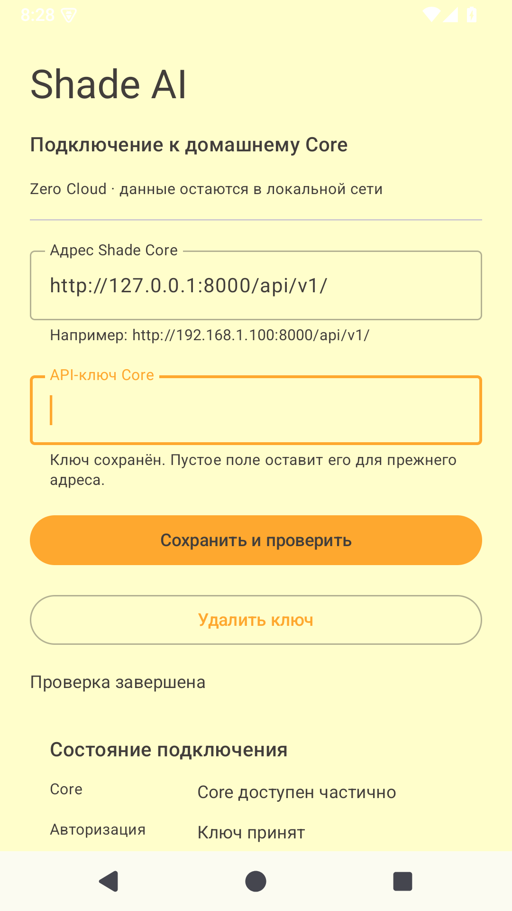

# TASK-09 — настройки и авторизация Android

**Дата:** 2026-10-17. **База:** `77cba4d` (TASK-07). **Статус:** программная часть реализована, аппаратная приёмка открыта.

Пользователь сообщил, что сейчас не может предоставить телефон/доступ к домашнему Pi, и разрешил делать доступную работу без них. Проверки выполнены на AOSP-эмуляторе и Core на компьютере; физический телефон не требуется для продолжения разработки, но остаётся критерием закрытия TASK-09. TASK-08 не выполнялась.

[Карточка](../mvp.md), [контекст](../project-context.md), [Android README](../../android/README.md).

## Изменения

- Адрес Core и скрытое поле API-ключа, сохранение/удаление, отдельные состояния Core/авторизации/БД/HA, безопасные сообщения ошибок. Валидация принимает корень или /api/v1/, нормализует путь; запрещает credentials, query, fragment, иной путь, пробелы и неподдерживаемую схему. HTTP проверяется по существующему точному списку Network Security Config до сетевого запроса. Сам список не расширялся.
- ConnectionViewModel/StateFlow вместо состояния и корутин в Activity. collectAsStateWithLifecycle, viewModelScope, отмена прежней проверки и generation-guard при редактировании/повторной проверке. Ключ не помещается в SavedState; toString снимка настроек и UI-состояния скрывает секреты. После сохранения поле ключа очищается.
- ServerPrefs хранит URL и AES-GCM шифротекст с IV в приватных SharedPreferences. AES-ключ — Android Keystore, AAD привязан к URL. Запись адреса/шифротекста атомарна через commit на IO; операции синхронизированы. Пустое поле оставляет ключ только для прежнего адреса; новый адрес требует нового ввода. Повреждённый шифротекст/Keystore дают безопасную ошибку без молчаливого сброса. Удаление ключа сохраняется после рестарта.
- ShadeApi получает явный снимок URL/ключа. Bearer отправляется защищённым маршрутам, health всегда без Bearer. Один базовый OkHttp-транспорт без хранения простаивающих соединений; connect/read/write/call timeout 3/5/5/10 секунд. Redirect, системный proxy и автоматический retry отключены; HTTPS со штатной проверкой сертификата. Неверный ключ, отказ сети, timeout, TLS, 3xx/4xx/5xx и неверный JSON не выводят тело ответа/исходное исключение в UI.
- Проверка авторизации выполняется GET notifications?limit=1 без создания записи; health и авторизация проверяются независимо. HA_AUTH_FAILED не смешивается с 401 ключа Core. Отказ HA не мешает служебной доставке в Core.
- Отдельная кнопка отправляет одну фиксированную служебную запись без личных данных с UUID event_id и актуальным временем. Сохранение/проверка настроек сами ничего не отправляют в историю. Stored/duplicate показывают ID, skipped — пропуск. Каждый новый ручной клик — отдельная попытка; автоматических повторов нет.
- NotificationListener использует те же сохранённые настройки/Bearer; без ключа защищённый HTTP не отправляется. Создание клиента перенесено в обрабатываемый блок, CancellationException не поглощается. Выбор источников/права/приватность до Room, устойчивый UUID буфера, статусы/очистка и фоновая доставка остаются TASK-10–12.
- В Manifest отключён Android backup, добавлены исключения cloud backup/device transfer для файлов, БД и prefs. XML для старого и нового формата сохранены. Поле ключа не отображает сохранённый секрет; палитра из брендбука и отступы системных панелей Android 15 проверены визуально.

Контракт и код Core, схема БД, веб и визитка не менялись. Runtime-зависимость добавлена только для lifecycle ViewModel той же версии 2.8.7; JUnit/MockWebServer/AndroidX Test относятся к test/androidTest. Версии записаны в catalog.

## Проверки

| Проверка | Результат |
| :--- | :--- |
| Core pytest | **126 passed**, 1 прежнее предупреждение Starlette/httpx |
| Web npm run build | Успешно |
| Android assembleDebug, testDebugUnitTest, lintDebug | BUILD SUCCESSFUL; **7 JVM-тестов**, lint 0 ошибок / 36 предупреждений версий/существующих ресурсов |
| connectedDebugAndroidTest | **4 теста**, 0 ошибок/пропусков на AOSP Android 15/API 35 |
| UI через ADB + отдельный Core | Сохранение, служебный POST, restart, 401/HA, URL/HTTP policy, отказ сети, привязка к адресу и удаление ключа |
| Ruff Python-стенда/сценария, локальные ссылки и git diff --check | Успешно перед коммитом |

Инструменты: JDK 17, Gradle Wrapper 8.10.2, AGP 8.7.3, Kotlin 2.0.21, SDK 35/Build Tools 34.0.0. Эмулятор ShadeTask03API35, AOSP API 35/x86_64, профиль Pixel 2, 2 CPU. Параметр памяти 1536 MiB эмулятор повысил до 2560 MiB; это ресурсы стенда, не измерение на Raspberry Pi. Подробнее об установленных инструментах — [TASK-03](task-03.md).

JVM-тесты [ConnectionTest.kt](../../android/app/src/test/java/com/shadeai/app/ConnectionTest.kt) проверяют нормализацию/отказ адреса, печатные символы ключа, отсутствие Authorization в health, Bearer и правильный путь в защищённом GET, отсутствие отправки без ключа, отказ следовать 302 с токеном и отсутствие повторов после 401. HTTP — MockWebServer на loopback, без внешних серверов.

Android-тесты [SettingsStoreTest.kt](../../android/app/src/androidTest/java/com/shadeai/app/SettingsStoreTest.kt) используют отдельный preferences-файл: реальный Android Keystore, round-trip/отсутствие plaintext/удаление, невозможность переназначить шифротекст другому URL, сохранение прежнего адреса без ключа, Network Security Config и выключенный backup-флаг. Производительность и hardware-backed Keystore физических устройств этими тестами не проверяются.

UI-сценарий [check_emulator.py](../../android/checks/check_emulator.py) запускается только для emulator-5554. [core_server.py](../../android/checks/core_server.py) задаёт синтетическое окружение до импорта приложения, меняет cwd на временный каталог, использует отдельную SQLite и отключённый HA. Он слушает только 127.0.0.1:8000; adb reverse связывает его с приложением. Рабочие .env/БД/HA не использовались, доступ к настоящим уведомлениям не выдавался.

Из UI проверены сохранение адреса/ключа, отдельный отказ HA при принятом ключе, служебная запись в SQLite и повторная проверка после force-stop. Проверены неверный ключ, неверный URL, запрет HTTP вне списка, обязательный ввод для другого адреса, отсутствие соединения и восстановление, удаление ключа с повторным запуском. Синтетический ключ отсутствует в XML prefs и logcat; в crash log нет падений приложения. При подготовке теста исправлены ненадёжный Ctrl+A в ADB-вводе и чтение устаревшей иерархии после null root UI Automator. Это изменения сценария, а не обход валидации приложения.

При UI-проверке первый служебный POST после паузы получал сетевой отказ без записи в Core, ручная следующая отправка сохранялась. Для исключения переиспользования простаивающих сокетов при отключённом retry пулу задан maxIdleConnections=0: завершённые соединения закрываются, автоматического повтора POST нет. JVM-тест проверяет новое соединение для следующего запроса. После изменения полный UI-сценарий прошёл, первый служебный POST сохранился в Core. Это увеличивает стоимость TCP/TLS подключения; дальнейшая оптимизация доставки/идемпотентных повторов остаётся TASK-12. Надёжность длительной эксплуатации не заявляется. Эмулятор во время подготовки завершался и был перезапущен; временная диагностическая запись класса ошибки из финального APK удалена.

## Готовность и следующий шаг

- [x] Код, сборка, JVM/Android-тесты и проверка настроек/авторизации в эмуляторе.
- [x] Служебный авторизованный POST из приложения сохранён в отдельной БД Core.
- [x] Ключ не хранится открыто в prefs и не найден в logcat; удаление/перезапуск проверены.
- [ ] Повторить сценарий на физическом телефоне, записать модель/Android/API и результат.

Общий чекбокс TASK-09 в mvp.md остаётся открытым. Для будущей аппаратной приёмки установить APK, настроить разрешённый локальный адрес/ключ, проверить 401/связь/служебный POST/перезапуск/удаление и отсутствие секретов в логах. Raspberry Pi для этой проверки не обязателен: Core может работать на компьютере.

Не проверены реальный перехват уведомлений, фоновые повторы, физический телефон/его Keystore и backup у разных OEM, реальный HA/Pi, TLS на настоящем LAN-сертификате и длительная эксплуатация. URL должен принадлежать доверенной LAN/VPN, автоматического ограничения частных DNS/IP нет. Удаление prefs логическое, защита от взломанного устройства/памяти процесса не заявляется.

Следующая доступная задача без домашнего железа — **TASK-10: разрешение уведомлений и выбор приложений**. TASK-08 ждёт Pi, TASK-03/09 — аппаратной приёмки. Все тестовые процессы останавливаются после проверки; APK, SDK, временные БД/логи не входят в git.

Основания: [Android Keystore](https://developer.android.com/privacy-and-security/keystore), [KeyGenParameterSpec: AES-GCM](https://developer.android.com/reference/android/security/keystore/KeyGenParameterSpec), [lifecycle в Compose](https://developer.android.com/topic/libraries/architecture/lifecycle), [backup и device transfer](https://developer.android.com/identity/data/autobackup). Проверено поведение реализации, а не только наличие зависимостей/файлов.
