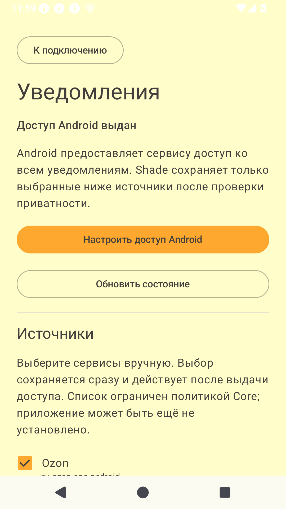
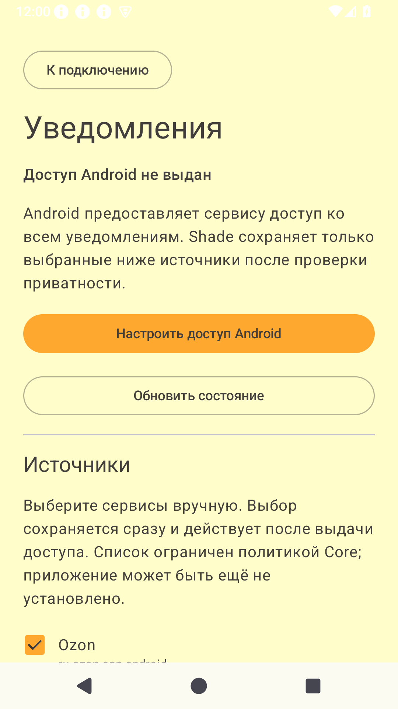

# TASK-10 — доступ к уведомлениям и управляемые источники

Дата: 2026-10-17–18. База: `2916688` (программная TASK-09). Проверки проведены без физического телефона и Raspberry Pi, по разрешению пользователя продолжать доступную разработку.

## Изменения

- Добавлен отдельный экран «Уведомления и источники»: состояние разрешения Android, переход в системные настройки, повторная проверка, выбор источников и возврат к настройкам подключения. Состояние обновляется при возврате Activity, навигация сохраняется при пересоздании. ViewModel/StateFlow, операции настроек/Room на IO, системные отступы и бренд-палитра сохранены.
- Каталог ограничен Ozon, Wildberries и Яндекс Go по политике TASK-05. На чистой установке и при обновлении с прежнего фиксированного списка **выбор пустой**. Настройки источников сохраняются отдельным SharedPreferences с commit; неизвестный пакет в старом/повреждённом выборе отсекается, включить его через API записи нельзя. Банки, SMS, мессенджеры в каталог не входят. Сканирование установленных приложений и QUERY_ALL_PACKAGES не нужны.
- NotificationListener ждёт подключения ОС; отбрасывает ongoing, foreground-service, group-summary и local-only уведомления. Общий NotificationCapture проверяет разрешение, актуальный выбор и текстовую политику до INSERT. Пустой текст и признаки кодов/паролей не сохраняются. Системная заглушка Android 15 о скрытом содержимом также отбрасывается по локализованному ресурсу ОС с английским fallback; дополнительные привилегии на чтение чувствительных уведомлений не запрашиваются. Фильтр использует одинаковый разбор Unicode-слов на JVM и Android; вариант с Java-флагом `(?U)` был отклонён инструментальными тестами и заменён.
- Выбор источников и отправка упорядочены Mutex. При выключении удаляются все локальные строки этого источника; перед отправкой pending повторяется проверка. Отзыв разрешения блокирует новый приём и очищает буфер при следующей проверке UI/сервиса. Корутины сервиса отменяются при disconnect/destroy. Схема Room v1 и контракт Core не менялись: добавлены только DAO-запросы удаления.
- Добавлены воспроизводимый сценарий [check_sources.py](../../android/checks/check_sources.py) и отдельные [синтетические издатели](../../android/checks/publisher/build.gradle.kts). Они подключаются только параметром notificationFixture, не являются зависимостью Shade и не входят в обычную сборку. Их packageName совпадают с разрешённым Ozon и запрещённым Telegram только для проверки системного пути в пустом AVD; метка явно тестовая, коммерческих приложений там нет. Скрипт проверяет эмулятор, свежий Core и отсутствие установленных пакетов перед установкой.

## Автоматические проверки

| Проверка | Результат |
|---|---|
| Core pytest | 126 passed, 1 прежнее предупреждение Starlette/httpx |
| Web npm run build | Успешно |
| Android assembleDebug / testDebugUnitTest / lintDebug | Успешно; 0 ошибок / 36 прежних предупреждений lint |
| JVM | 10 passed: 7 прежних транспортных и 3 новых теста политики |
| Instrumented, AOSP Android 15 / API 35 | 10 passed: 4 прежних Keystore/transport и 6 новых выбора/Room/приватности/конкурентного отключения |

Новые инструментальные тесты используют отдельные preferences с префиксом task10_test и in-memory Room, без изменения ключа/БД экрана. Проверяют пустой выбор и сохранение, недопуск неизвестных пакетов, отсутствие INSERT/транспортного вызова при запрете, удаление офлайн-буфера, отзыв доступа, отбрасывание старой чувствительной pending-строки и порядок отключения при запросе в полёте. JVM отдельно проверяет все три допустимых источника, банки/мессенджеры/SMS и русский/английский фильтр в обоих полях.

## Проверка системного пути на эмуляторе

Сценарий использует системную публикацию уведомлений из отдельного APK, настоящий NotificationListener и реальную Room-БД debug-приложения. Core принимает данные через HTTP/Bearer в отдельную SQLite. Сверяются одновременно число записей Core и снимок Room с WAL; для положительного случая дополнительно сверены исходные title/text.

| Сценарий | Core / Room после проверки |
|---|---|
| Чистая установка, все три источника выключены; выдача разрешения через системный UI | 0 / 0 |
| Уведомление Ozon при выключенном источнике | 0 / 0 |
| Включение Ozon и обычное уведомление с точным текстом | 1 / 1 |
| Код, ongoing, group summary, local-only и синтетический Telegram | Осталось 1 / 1 |
| Отключение Ozon и новая публикация | 1 / 0 |
| Force-stop и повторный запуск | Выключенный и включённый выбор сохраняются |
| Офлайн-уведомление после повторного включения, затем отключение и возврат связи/rebind | Буфер 1 → 0; Core остаётся 1, повторной отправки нет |
| Включение, ещё одно обычное уведомление, отзыв через системный UI | 2 / 1 → 2 / 0 |
| Новое уведомление после отзыва | Осталось 2 / 0; UI показывает отсутствие доступа |

В сценарии sensitive Android 15 может сам скрыть исходный текст: проверен пропуск системной заглушки. Отбрасывание исходного текста с кодом до INSERT дополнительно проверено в инструментальном тесте через тот же NotificationCapture. Это не обход системной защиты.

Crash log не содержит FATAL EXCEPTION; тестовый API-ключ и синтетический текст кода отсутствуют в logcat. Снимки содержат только проверочные данные. После прогона синтетические издатели удаляются, тестовый Core и AVD останавливаются, reverse-порт убирается.

## Стенд

JDK 17, Gradle Wrapper 8.10.2, AGP 8.7.3, SDK 35, AVD ShadeTask03API35 (AOSP Android 15, x86_64, Pixel 2). Штатный эмулятор использует KVM/Swiftshader. Изолированный [Core](../../android/checks/core_server.py) создаёт временную SQLite и безопасный тестовый ключ, HA выключен; рабочие .env/БД/HA не читаются. Соединение — adb reverse с loopback. Уведомления содержат только фиксированную синтетику. Ключи, БД, APK, SDK и сырые логи остаются в игнорируемых каталогах. Инструкция воспроизведения — [Android README](../../android/README.md#воспроизведение-проверки-источников-без-телефона).

## Снимки эмулятора

## Ограничения

- Разрешение Android даёт listener широкий доступ; прикладная политика ограничивает последующее хранение и отправку. Текстовый фильтр консервативен, не является универсальным детектором секретов. Уведомления реальных приложений и особенности OEM ещё не проверены; формат системной заглушки может различаться между прошивками.
- Уже начатый запрос может завершиться до подтверждения отключения; UI ждёт освобождения Mutex, сетевой timeout до 10 секунд. Уже доставленные в Core строки не удаляются. При убийстве процесса немедленное удаление файла локальной БД после отзыва доступа не гарантируется; очистка идёт при следующей проверке/подключении.
- Свободный выбор любых приложений намеренно отсутствует: расширение каталога требует согласования политики Core/Android. Если Core настроен на меньший список, он может вернуть skipped.
- Разные форматы текста, идентификаторы, обновления/дубли, статусы/retention и длительный lifecycle остаются TASK-11; восстановление сети/backoff и различение ответов/ошибок — TASK-12; журнал и полная проверка телефона — TASK-13. Текущая одиночная попытка отправки не доказывает надёжную фоновую доставку.
- API 26 fallback реализован, но текущая проверка выполнена на API 35. Физические критерии TASK-03/09 и развёртывание TASK-08 остаются открыты.

## Источники платформенного контракта

[NotificationListenerService](https://developer.android.com/reference/android/service/notification/NotificationListenerService) — декларация с BIND_NOTIFICATION_LISTENER_SERVICE и exported=false, ожидание подключения и disconnect. [NotificationManager](https://developer.android.com/reference/android/app/NotificationManager#isNotificationListenerAccessGranted(android.content.ComponentName)) — проверка разрешения на API 27+ и системный переход. [Notification flags](https://developer.android.com/reference/android/app/Notification#FLAG_GROUP_SUMMARY) — признаки служебных/сводных уведомлений.

Защита Android 15 от чтения OTP описана в [официальных изменениях поведения](https://developer.android.com/about/versions/15/behavior-changes-all#otp-redaction).
