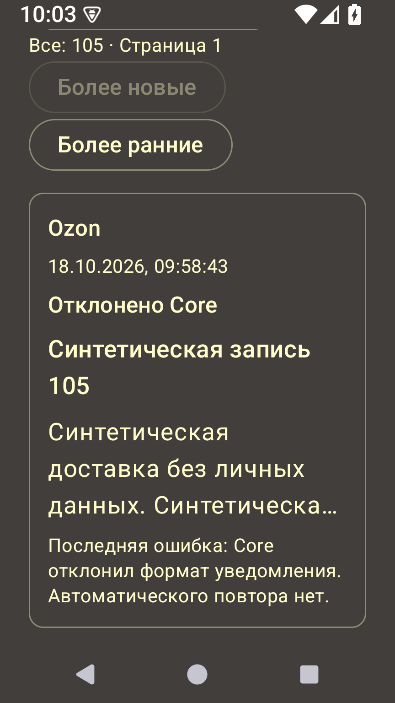
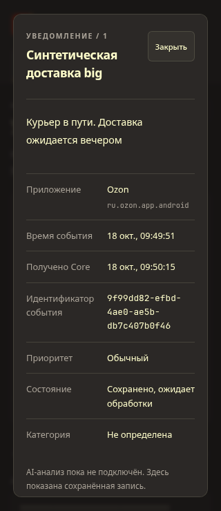

# TASK-13 — Android-журнал и сквозная программная проверка

**Дата:** 2026-10-18. **База:** `90c7336`. Коммит программной части определяется по TASK-13 в git log. **Общий TASK-13 открыт:** реальный телефон и Core на Pi недоступны, аппаратные критерии не заменены эмулятором. Следующая доступная разработка — TASK-14.

## Что реализовано

- Экран «Журнал уведомлений»: источник, время события, title/text, пять состояний доставки, безопасное пояснение последней ошибки. Карточка открывает полный текст, UUID, время сохранения/завершения и число завершённых попыток. SENT означает подтверждение Core, не AI-обработку.
- Пять фильтров, страницы до 50 строк с границей ID, переход к старым/новым; новая вставка не сдвигает старую страницу. Глобальные счётчики всего буфера/очереди, минимальное время повтора/401-пауза. Ошибка/смена фильтра очищает старые строки; пустая старая страница возвращается к первой.
- NotificationJournal читает страницу, счётчики и gate одной Room-транзакцией. InvalidationTracker.Observer/callbackFlow совместимы с текущим Room 2.6.1; подписка удаляется при отмене. JournalRoute наблюдает только при STARTED, закрывает подписку и очищает тексты при STOP/выходе. SavedState содержит маршрут/ID карточки, без payload/ключей.
- Перед чтением выполняется общий capture.refresh: выбор/доступ/приватность/TTL. Чтение не меняет backoff/401 и не пересылает записи. Неизвестные категории ошибок показываются безопасным fallback без raw-значения. Это локальный ограниченный буфер, не полный архив уведомлений Android.
- Состояния загрузки, пустого списка, пустого фильтра, сбоя чтения и обновления. Светлая/тёмная бренд-палитра, safeDrawing, перенос фильтров, LazyColumn и прокрутка длинной карточки. Иконки системных панелей адаптированы к теме. Убраны прежние UI-подписи о ещё отсутствующей доставке.
- Web-детали показывают UUID отправителя для сопоставления с Android; legacy без UUID обозначен явно. REST, Room v3 и зависимости приложения не менялись. LLM/привычки по-прежнему отсутствуют.

## Подтверждённые проверки

Окружение: JDK 17, Gradle 8.10.2/AGP 8.7.3/Kotlin 2.0.21, AOSP Android 15/API 35 x86_64 (ShadeTask03API35), Chromium через Playwright CLI. Все события синтетические; рабочие .env/БД/HA/телефон не использовались.

| Проверка | Результат |
|---|---|
| Core pytest | 126 passed, прежнее предупреждение Starlette/httpx |
| JVM | 18 passed: в том числе безопасные тексты ошибок, разные статусы и revision/backoff UI |
| Android instrumented | 42 passed: в том числе пустой журнал, 106+1 строк/граница ID, фильтры/глобальные счётчики, обновление при неизменном count, атомарные row/gate, удаление просмотренной страницы |
| Сборки Android/Web | Успешно |
| Android lint | 0 ошибок / 39 прежних предупреждений |
| Ruff Core/сценарии, локальные ссылки, diff | Успешно перед коммитом |

[Системный сценарий](../../android/checks/check_journal.py) использует отдельный синтетический издатель и [свежий Core](../../android/checks/core_server.py):

1. Чистое приложение показывает пустой журнал. Wi-Fi/data off → настоящее системное уведомление → Room PENDING; в Android доступны полный текст и сохранённый UUID, Core пуст.
2. Wi-Fi on → WorkManager подтверждает отправку, журнал сам меняется на «Получено Core». UUID/title/text/postTime совпадают с API и read-only SQL в отдельной notifications_raw (ключ event:UUID). Повтор callback и force-stop/start не создают дубля.
3. Уведомление Inbox доставлено при `mWakefulness=Asleep` на AOSP API 35. После пробуждения журнал показывает две записи. Это не проверка Doze/OEM физического телефона.
4. Отключение источника удаляет локальную историю. Новая pending после повторного включения удаляется при отзыве доступа/обновлении журнала. В Core остаются две ранее полученные записи.

[Веб-сценарий](../../web/checks/android-journal.js) через [helper](../../android/checks/check_journal_web.py) сверяет эту же запись: UUID, полный текст и исходный timestamp одинаковы в Android/Core SQLite/Web. Проверены ширина 320 px, отсутствие overflow UUID, Escape/reload, две записи без дубля, отсутствие внешних запросов и JS-ошибок. Сохранённые снимки — web/output/playwright (игнорируются Git).

[UI-сценарий страниц](../../android/checks/check_journal_pages.py) готовит 105 синтетических строк в копии пустой debug Room при остановленном AVD-приложении. Проверены 50/50/5 и возврат, пять фильтров/счётчики 21/42, длинный текст без обрезки в деталях, тёмная тема, около 329 dp/шрифт 1.3. Paused-gate сохраняется и эти строки не отправляются в Core. SQL-подготовка существует только в checks, не встроена в APK.

Команды/порядок запуска и очистка — [Android README](../../android/README.md#воспроизведение-программной-task-13). Сначала Gradle, затем UI-сценарии: инструментальный раннер может удалить debug-приложение и его данные. Использовать одноразовый AVD. В одном прогоне завис System UI эмулятора; после закрытия системного ANR-диалога сценарий повторён. В crash log Shade падений нет, тестовый ключ не найден в logcat.

## Снимки синтетического стенда

Android, около 329 dp/шрифт 1.3, локальная SQL-fixture для проверки UI:

Веб, 320 px, запись реального синтетического listener с UUID:

Тестовые Core/Vite/Chromium/AVD после проверки остановлены, adb reverse отсутствует.

## Что остаётся для закрытия

- Физический телефон: записать модель/Android/настройки энергосбережения; реальное допустимое уведомление выбранного сервиса увидеть в Android и вебе, сопоставить UUID/текст/время.
- На телефоне повторить сеть off/on, повтор/перезапуск, отключение источника/отзыв доступа, длительное выключение экрана и фактическую фоновую доставку с фиксацией задержек. Эмуляторный Asleep не подтверждает эти условия.
- Для закрытия v0.2 повторить путь с Core на Pi после TASK-08, сохранить результаты и ограничения. TASK-03/09/11 также сохраняют свои аппаратные критерии.

API 26 проверен совместимостью сборки/lint, runtime выполнялся на API 35. Сбой чтения имеет безопасный UI-state; реальная порча/аппаратный отказ flash не моделировались. Не обещается мгновенная доставка, постоянный архив или обход Doze/force-stop. Ручного повтора отдельного REJECTED нет. Никакое железо повторно у пользователя не запрашивалось.

Основания: официальные [асинхронные запросы Room](https://developer.android.com/training/data-storage/room/async-queries), [InvalidationTracker.Observer](https://developer.android.com/reference/androidx/room/InvalidationTracker.Observer), [ленивые списки Compose](https://developer.android.com/develop/ui/compose/lists). Использован [Playwright CLI](../../web/README.md#сопоставление-с-android-программная-task-13) через существующий CLI; производственные зависимости не добавлялись.
